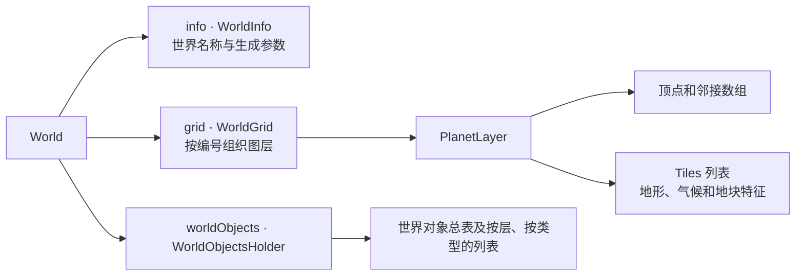
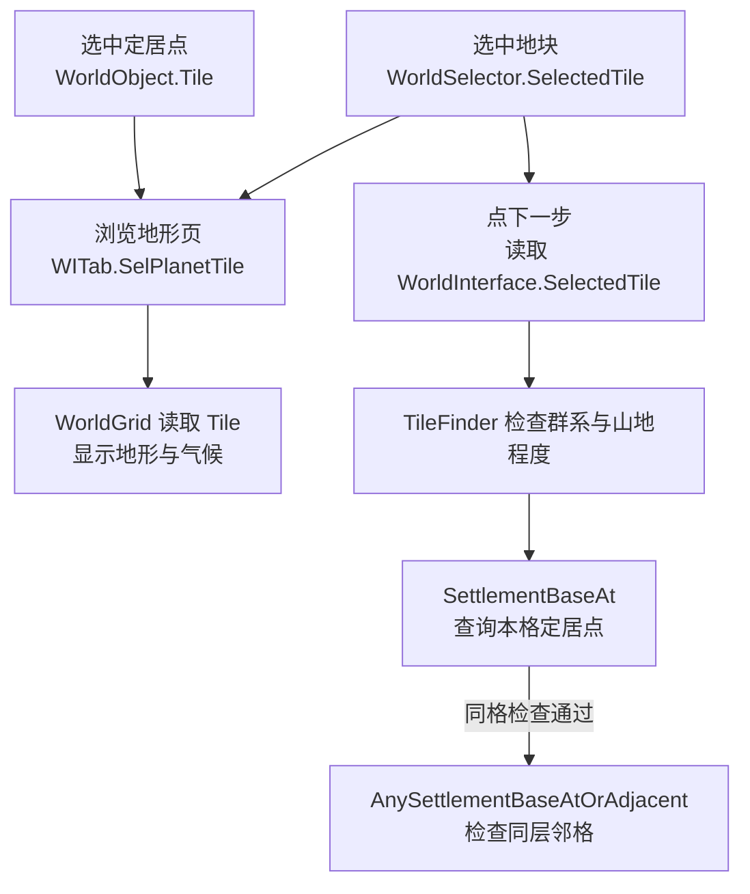
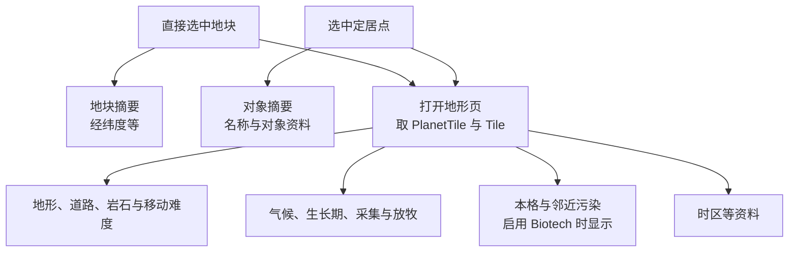

# 世界数据的存储与查询

第 07 章子章讨论稿，承接[世界生成主章](article.md)和[气候与地形规则](01-climate-terrain-rules.md)。沿一格地块追踪数据在内存中放在哪里、世界地图怎样查询和显示它，以及读档时怎样恢复它。

## 常用查询方法

表里的 `tile` 是 `PlanetTile`，用图层编号和层内地块编号表示世界位置。例如，一张地图的 `map.Tile` 和一个世界对象的 `worldObject.Tile` 都提供这个位置值。从世界地图当前选区取得位置的过程见 [3.1](#31-地形页从当前选择取得位置)。

| 想查什么 | 调用或读取方式 | 得到什么 | 详解 |
| --- | --- | --- | --- |
| 一格的地形和气候记录 | `Find.WorldGrid[tile]` | 返回 `Tile`，可读取 `PrimaryBiome`、`hilliness`、`temperature`、`rainfall` 等。 | [2.2](#22-先找图层再按编号取地块) |
| 地块编号是否在范围内 | `Find.WorldGrid.InBounds(tile)` | 在图层已知存在时，检查 `tileId` 是否落在该层的地块范围内。 | [2.2](#22-先找图层再按编号取地块) |
| 同一图层的邻格 | `Find.WorldGrid.GetTileNeighbors(tile, neighbors)` | 先清空调用方提供的 `List<PlanetTile>`，再填入邻格。 | [2.4](#24-读取并比较同层邻格) |
| 地块中心的经纬度 | `Find.WorldGrid.LongLatOf(tile)` | 返回 `Vector2`，`x` 为经度，`y` 为纬度。 | [4.1](#41-从坐标地形和道路读出地块概况) |
| 本格的定居点 | `Find.WorldObjects.SettlementBaseAt(tile)` | 返回找到的 `Settlement`，没有则返回 `null`。 | [3.2](#32-确认落点时检查本格与邻格的定居点) |
| 本格或邻格是否有定居点 | `Find.WorldObjects.AnySettlementBaseAtOrAdjacent(tile)` | 返回 `bool`，只检查同一图层。 | [3.2](#32-确认落点时检查本格与邻格的定居点) |
| 本格的某类世界对象 | `Find.WorldObjects.WorldObjectAt<Caravan>(tile)` | 以远行队为例，返回第一个匹配的对象，没有则返回 `null`。 | [3.3](#33-查同一格上的其他世界对象) |
| 本格的天然岩石种类 | `Find.World.NaturalRockTypesIn(tile)` | 返回岩石的 `ThingDef` 序列。 | [4.1](#岩石种类怎样抽取) |
| 本格当前的季节气温 | `GenTemperature.GetTemperatureFromSeasonAtTile(GenTicks.TicksAbs, tile)` | 返回基础平均温度加上当前时刻的季节偏移，单位为摄氏度。 | [4.2](#42-从季节温度算出生长期) |
| 地形页的生长期 | `Zone_Growing.GrowingQuadrumsDescription(tile)` | 返回显示文本，例如「全年」或 `40/60` 天及对应时段。 | [4.2](#42-从季节温度算出生长期) |
| 本格现在能否放牧 | `VirtualPlantsUtility.EnvironmentAllowsEatingVirtualPlantsNowAt(tile)` | 根据主群系的植被条件和当前季节气温返回 `bool`。 | [4.3](#43-植被怎样影响放牧和远行采集) |
| 本格和邻近污染 | `Find.WorldGrid[tile].pollution`、`WorldPollutionUtility.CalculateNearbyPollutionScore(tile)` | 前者是本格的污染比例，后者把本格和搜索到的邻近地块的污染值按距离加权求和。 | [4.4](#44-分别读取本格污染与邻近污染) |

## 一、`World` 怎样组织世界数据

世界地图上的一格有自己的地形和气候，也可能有道路、河流、地标或定居点。沿一个 `PlanetTile` 看，`WorldGrid` 持有地块和它的几何关系，`WorldObjectsHolder` 持有定居点与远行队等对象。`WorldInfo` 还留着创建世界时使用的参数。



### 1.1 `World` 保存各部分的入口

`World` 的相关字段如下。生成时，`Grids` 步骤创建 `grid` 和 `pathGrid`，`ConstructComponents()` 创建 `worldObjects`、`factionManager` 和 `worldPawns` 等对象。进入游戏后，`Find.WorldGrid` 和 `Find.WorldObjects` 也是从 `Find.World` 的这些字段取得对应对象的。

```csharp
// 世界范围的设置和名称。
public WorldInfo info = new WorldInfo();
// 各世界系统登记的组件。
public List<WorldComponent> components = new List<WorldComponent>();
// 派系实例与世界 Pawn 各有自己的管理对象。
public FactionManager factionManager;
public WorldPawns worldPawns;
// 定居点、远行队等世界对象从这里取得。
public WorldObjectsHolder worldObjects;
// 世界地图上的命名地貌与 Odyssey 地标。
public WorldFeatures features;
public WorldLandmarks landmarks;
// 地块与图层数据，以及从地形算出的寻路代价。
public WorldGrid grid;
public WorldPathGrid pathGrid;
```

`WorldInfo` 的 `overallRainfall` 和 `overallTemperature` 是整个世界的生成档位。生成出的每格降雨和温度随后写入该格的 `Tile`。`factions` 是创建世界时选定的 `FactionDef` 列表，随后生成的派系实例由 `factionManager` 持有。`WorldInfo.Seed` 会用 `GenText.StableStringHash(seedString)` 取得对应的整数种子。

```csharp
// 世界名称、覆盖率和种子字符串。
public string name = "DefaultWorldName";
public float planetCoverage;
public string seedString = "SeedError";
// 影响生成的世界设置。
public OverallRainfall overallRainfall = OverallRainfall.Normal;
public OverallTemperature overallTemperature = OverallTemperature.Normal;
public OverallPopulation overallPopulation = OverallPopulation.Normal;
public LandmarkDensity landmarkDensity = LandmarkDensity.Normal;
// 记录初始地图尺寸，以及创建世界时选定的派系定义和污染设定。
public IntVec3 initialMapSize = new IntVec3(250, 1, 250);
public List<FactionDef> factions;
public float pollution;
```

源码见 `RimWorld.Planet.World.cs:169`、`:531`、`RimWorld.Planet.WorldInfo.cs:22`、`:65`、`RimWorld.Planet.GameSetupStep_Grids.cs:21` 和 `Verse.Find.cs:810`、`:820`。

### 1.2 `WorldGrid` 按编号保存图层

`planetLayers` 是以整数层编号为键的字典。`RegisterPlanetLayer()` 从 `nextLayerId` 取出编号，再按 `PlanetLayerDef.layerType` 创建对应的对象并登记进字典。外部代码通过 `PlanetLayers` 的只读字典接口访问这些层。`surface` 和 `orbit` 分别保留地表层和轨道层的引用。

```csharp
// 按层编号存放图层对象，注册新层时从 nextLayerId 分配编号。
private Dictionary<int, PlanetLayer> planetLayers = new Dictionary<int, PlanetLayer>();
private int nextLayerId;
// 保存地表和轨道层的引用。
private SurfaceLayer surface;
private PlanetLayer orbit;
// 通过只读字典接口提供对现有图层的访问。
public IReadOnlyDictionary<int, PlanetLayer> PlanetLayers
{
    get
    {
        return this.planetLayers;
    }
}
```

例如，原版地表配置使用 `SurfaceLayer`，`Terrain` 步骤会在这一层填入 `SurfaceTile`。Odyssey 的 `Orbit` 使用 `OrbitLayer`，它的 `Tiles` 步骤会用本层的默认群系建立普通 `Tile`。两层各有自己的列表，因此地表第 42 格和轨道第 42 格可以同时存在。

定义见 Core 和 Odyssey 各自的 `Defs/PlanetLayerDefs/PlanetLayers.xml`。源码见 `RimWorld.Planet.WorldGrid.cs:97`、`:239`、`:320`、`:986`、`RimWorld.Planet.WorldGenStep_Terrain.cs:174` 和 `RimWorld.Planet.WorldGenStep_Tiles.cs:31`。

### 1.3 `PlanetLayer` 保存地块列表和几何数组

每个 `PlanetLayer` 都持有一个 `List<Tile>`，`Tiles` 属性直接返回这个列表。逐格生成时，生成器从编号 `0` 开始依次加入记录。地块的形状和邻接关系则在网格初始化时建好，所以在 `Tiles` 填入对象之前，就能从 `tileIDToNeighbors_offsets.Length` 得到 `TilesCount`。

```csharp
// 按 tileId 排列这一层的地块对象。
protected readonly List<Tile> tiles = new List<Tile>();
public List<Tile> Tiles
{
    get
    {
        return this.tiles;
    }
}
// 从几何网格取得地块数量。
public int TilesCount
{
    get
    {
        return this.tileIDToNeighbors_offsets.Length;
    }
}
// 各格的顶点坐标排在同一个数组中。
private NativeArray<Vector3> verts;
// 按地块编号定位顶点范围。
private NativeArray<int> tileIDToVerts_offsets;
// 用两份数组定位并保存各格的邻接地块。
private NativeArray<int> tileIDToNeighbors_offsets;
private NativeArray<PlanetTile> tileIDToNeighbors_values;
```

每种几何数据用两份数组配合保存。一份把各格的内容首尾相接排好，另一份记录每格从哪里开始。`verts` 放顶点坐标，`tileIDToVerts_offsets` 给出各格的顶点起点。`tileIDToNeighbors_values` 放相邻地块的 `PlanetTile`，`tileIDToNeighbors_offsets` 给出各格的邻接记录起点。

第 [2.4](#24-读取并比较同层邻格) 节会用第 `42` 格说明这两份邻接数组怎样配合读取。

源码见 `RimWorld.Planet.PlanetLayer.cs:114`、`:445`、`:1553`、`:1571`。

### 1.4 `Tile` 和 `SurfaceTile` 各保存什么

`Tile` 是一格的记录。`tile` 字段给出它在世界中的位置。`PrimaryBiome` 属性读写内部的 `biome` 字段，保存的是 `BiomeDef` 引用。海拔、气温、降雨等是这一格自己的数值。地图元素列表里存的是 `TileMutatorDef` 引用，界面读取 `Mutators` 属性时，空字段会返回空列表。

```csharp
// PrimaryBiome 属性读写这个群系定义引用。
private BiomeDef biome;
// 当前地块的海拔、山地程度和气候值。
public float elevation = 100f;
public Hilliness hilliness;
public float temperature = 20f;
public float rainfall;
public float swampiness;
// 这格所属的命名地貌，以及这格的污染程度。
public WorldFeature feature;
public float pollution;
// 这条记录在世界中的位置与附在该格上的地图元素。
public PlanetTile tile;
public List<TileMutatorDef> mutatorsNullable;
```

地表使用 `SurfaceTile : Tile`。这个子类增加道路和河流列表。`RoadLink`、`RiverLink` 中的 `neighbor` 是另一端的位置，`road` 或 `river` 指向该路段选择的定义。比如 A 到 B 铺了一段道路，`OverlayRoad()` 会在 A 记一条指向 B 的记录，也在 B 记一条指向 A 的记录。地形页通过 `Roads` 和 `Rivers` 读取连接，这两个属性会先检查当前群系是否允许道路或河流。

河流也在两端各写一条记录。`OverlayRiver()` 登记河段时，会用来处的 `riverDist` 加一更新另一端，并保留已有值与新值中的较大者。

```csharp
// 保存和邻格相连的道路与河段。
public List<SurfaceTile.RoadLink> potentialRoads;
public List<SurfaceTile.RiverLink> potentialRivers;
// 河流生成时写入的沿河距离值。
public int riverDist;
// 道路的另一端，以及该边使用的道路定义。
public struct RoadLink
{
    public PlanetTile neighbor;

    public RoadDef road;
}
// 河段的另一端，以及该边使用的河流定义。
public struct RiverLink
{
    public PlanetTile neighbor;

    public RiverDef river;
}
```

源码见 `RimWorld.Planet.Tile.cs:24`、`:94`、`:377`、`RimWorld.Planet.SurfaceTile.cs:23`、`:100` 和 `RimWorld.Planet.WorldGrid.cs:556`、`:634`、`:683`。

### 1.5 定居点与远行队放在世界对象列表里

定居点和远行队都有自己的 `WorldObject`。对象的 `ID` 由 `WorldObjectMaker` 分配，`def` 指向它的 `WorldObjectDef`，位置存在内部字段 `tile`，经 `Tile` 属性读取。这样，停在同一个地块的定居点与远行队各有自己的对象和编号，也可以持有相同的位置值。

```csharp
// 对象使用的定义与它自己的编号。
public WorldObjectDef def;
public int ID = -1;
// 对象所在的世界位置及所属派系。
private PlanetTile tile = PlanetTile.Invalid;
private Faction factionInt;
```

`WorldObjectsHolder` 保存总列表和几组便于查询的集合。`layerWorldObjects` 以 `PlanetLayer` 对象为键，`settlementBases`、`caravans` 和 `mapParents` 等列表按对象种类收录。`worldObjectsHashSet` 给 `Contains()` 用来检查某个对象是否已登记。

```csharp
// 登记在世界中的对象总列表。
private List<WorldObject> worldObjects = new List<WorldObject>();
// 按对象所在图层保留引用。
private readonly Dictionary<PlanetLayer, List<WorldObject>> layerWorldObjects = new Dictionary<PlanetLayer, List<WorldObject>>();
// 供 Contains() 检查对象是否已加入世界。
private readonly HashSet<WorldObject> worldObjectsHashSet = new HashSet<WorldObject>();
// 按对象种类保存引用，供各系统查询。
private readonly List<Caravan> caravans = new List<Caravan>();
private readonly List<Settlement> settlements = new List<Settlement>();
private readonly List<Settlement> settlementBases = new List<Settlement>();
private readonly List<MapParent> mapParents = new List<MapParent>();
```

`Add(WorldObject o)` 检查传入对象后，先加入总列表，再调用 `AddToCache()`。下面接着看 `AddToCache()` 对有效位置和定居点做了什么。`o` 是刚加入的对象，`list` 是该对象所在层的列表。一个 `Settlement` 可以同时被图层列表、定居点列表和地图父对象列表引用。

```csharp
// 先加入总列表，再把同一个对象登记到对应的查询集合。
this.worldObjects.Add(o);
this.AddToCache(o);
// 完成登记后再执行对象加入世界时的初始化。
o.SpawnSetup();
o.PostAdd();
```

```csharp
// 把对象放入用于成员查询的集合。
this.worldObjectsHashSet.Add(o);
// 位置有效时，找到或创建本层的对象列表。
if (o.Tile.Valid)
{
    List<WorldObject> list;
    if (!this.layerWorldObjects.TryGetValue(o.Tile.Layer, out list))
    {
        list = (this.layerWorldObjects[o.Tile.Layer] = new List<WorldObject>());
    }
    list.Add(o);
}
// 定居点还要加入两份定居点查询列表。
Settlement settlement = o as Settlement;
if (settlement != null)
{
    this.settlements.Add(settlement);
    this.settlementBases.Add(settlement);
}
```

`Remove()` 也会同步从总列表移除对象并调用 `RemoveFromCache()`。读档时，`Recache()` 会从恢复好的总列表重建这些查询集合，第五节会接着看这个过程。

源码见 `RimWorld.Planet.WorldObject.cs:93`、`:874`、`RimWorld.Planet.WorldObjectMaker.cs:17`、`RimWorld.Planet.WorldObjectsHolder.cs:260`、`:287`、`:315`、`:353`、`:425`、`:445`、`:738` 和 `RimWorld.Planet.Settlement.cs:10`。

### 1.6 同一个位置还关联哪些数据

| 数据 | 存在哪里 | 怎样和地块联系起来 |
| --- | --- | --- |
| Odyssey 地标 | `WorldLandmarks` 的 `landmarks` 字典，类型为 `Dictionary<PlanetTile, Landmark>`。 | 用地块位置作键，取得该格的地标。 |
| 有名称的大片地貌 | `WorldFeatures` 的 `features` 列表，类型为 `List<WorldFeature>`。 | 同一片地貌的成员地块都用 `Tile.feature` 引用那一个区域对象。 |
| 世界寻路代价 | `WorldPathGrid` 的 `layerMovementDifficulty` 字典，类型为 `Dictionary<PlanetLayer, float[]>`。 | 每个图层有一份长度为 `TilesCount` 的代价数组，并用 `tileId` 定位其中一项。 |

例如，假设地表的层编号为 `0`。选择 `new PlanetTile(42, 0)` 后，地形和气候在该层的 `Tiles[42]`。相邻地块由该层的邻接数组给出。如果这格有定居点，定居点对象保存在 `worldObjects`，它的 `Tile` 指向同一个位置。下一节从这两个编号怎样找到正确的层与地块读起。

源码见 `RimWorld.Planet.WorldLandmarks.cs:11`、`:82`、`RimWorld.Planet.WorldFeatures.cs:202`、`RimWorld.FeatureWorker.cs:18`、`RimWorld.Planet.WorldPathGrid.cs:54`、`:80`、`:241` 和 `RimWorld.Planet.PlanetTile.cs:68`。

## 二、通过 `PlanetTile` 定位图层和地块

沿用地表第 `42` 格的例子。代码先用层编号找到图层，再用层内编号读取地块或邻接数据。需要比较两个位置时，还要看它们是否属于同一图层。

### 2.1 用两个编号表示一个世界位置

`PlanetTile` 是一个 `readonly struct`。`tileId` 是层内编号，`layerId` 是层编号。以下节选自结构体的字段和构造函数。传入 `PlanetLayer` 时，构造函数只从层对象取出 `LayerID` 写入结构体。

```csharp
// 保存层内编号和图层编号，以及表示无效位置的值。
public readonly int tileId;
private readonly int layerId;
public static readonly PlanetTile Invalid = new PlanetTile(-1);

// 已知层对象时，取它的编号组成位置。
public PlanetTile(int tileId, PlanetLayer layer)
{
    this = new PlanetTile(tileId, layer.LayerID);
}

// 单参数写法固定使用编号 0 的图层。
public PlanetTile(int tileId)
{
    this.tileId = tileId;
    this.layerId = 0;
}

// 直接用两个编号构造。层内编号写在前面。
public PlanetTile(int tileId, int layerId)
{
    this.tileId = tileId;
    this.layerId = layerId;
}
```

开发者模式下，地形页的 `Debug world tile ID` 会调用 `ToString()`，按 `tileId,layerId` 显示。例如 `42,0` 表示编号为 `0` 的图层中的第 `42` 格。`TryParse()` 也接受这个格式。输入只有一个数字时，它走单参数构造函数，所以 `42` 会读成 `42,0`。

隐式转换也沿用这套写法。转成 `int` 时只取出 `tileId`，从 `int` 转回时调用单参数构造函数。因此把轨道上的 `42,1` 转成整数再转回，得到的是 `42,0`。

源码见 `RimWorld.Planet.PlanetTile.cs:8`、`:55`、`:121`、`:133`、`:162`、`:172` 和 `RimWorld.Planet.WITab_Terrain.cs:87`。

### 2.2 先找图层，再按编号取地块

`PlanetTile.Layer` 会到上一节的 `WorldGrid` 找图层。层编号为负时，直接取 `Surface`。其余情况用 `layerId` 查 `PlanetLayers` 字典。

```csharp
public PlanetLayer Layer
{
    get
    {
        // 负层编号使用当前世界登记的地表层。
        if (this.layerId < 0)
        {
            return Find.WorldGrid.Surface;
        }
        // 用实际的图层编号查世界网格里的字典。
        return Find.WorldGrid.PlanetLayers[this.layerId];
    }
}
```

`WorldGrid` 提供两种索引方式。`Find.WorldGrid[42]` 走 `int` 版本，从地表取第 `42` 格。`Find.WorldGrid[new PlanetTile(42)]` 走位置版本，从层编号 `0` 取第 `42` 格。当图层 `0` 就是地表时，两种写法能取到同一条记录。

```csharp
// 直接给整数时，使用地表层的索引器。
public SurfaceTile this[int tileID]
{
    get
    {
        return this.surface[tileID];
    }
}

// 给一个 PlanetTile 时，先找到它所属的层，再索引该层的列表。
public Tile this[PlanetTile tile]
{
    get
    {
        return tile.Layer.Tiles[tile.tileId];
    }
}
```

也可以用 `PlanetTile` 的 `Tile` 属性取数据。它调用 `this.Layer[this.tileId]`，也就是该层的整数索引器。

`Valid` 只检查 `tileId >= 0`。`PlanetTile.Invalid` 的 `tileId` 为 `−1`，而 `default(PlanetTile)` 的两个字段都是 `0`，因此后者会通过 `Valid`。`WorldGrid.InBounds()` 先找到图层，再用该层的 `InBounds()` 判断编号是否落在 `0` 到 `TilesCount - 1`。例如，在只有 `100` 格的图层里，第 `120` 格的 `Valid` 为 `true`，`InBounds()` 返回 `false`。`WorldGrid[PlanetTile]` 会直接索引 `Tiles`，所以调用时需要已知图层和可用的地块编号。

源码见 `RimWorld.Planet.PlanetTile.cs:12`、`:22`、`:46`、`:178`、`RimWorld.Planet.WorldGrid.cs:155`、`:165`、`:418` 和 `RimWorld.Planet.PlanetLayer.cs:273`、`:861`。

### 2.3 比较两个位置是否指向同一格

`==` 使用 `Equals()`。代码先比较层内编号，再比较层编号。若层编号不同，最后检查两者是否都表示根地表。`flag` 和 `flag2` 分别记录当前值和 `other` 是否满足这个条件。

```csharp
public bool Equals(PlanetTile other)
{
    // 层内编号相同，才继续比较图层。
    if (this.tileId != other.tileId)
    {
        return false;
    }
    if (this.layerId == other.layerId)
    {
        return true;
    }
    // 负层编号和显式指定的根地表编号可以表示同一格。
    bool flag = this.layerId < 0 || this.Layer.IsRootSurface;
    bool flag2 = other.layerId < 0 || other.Layer.IsRootSurface;
    return flag && flag2;
}
```

假设根地表编号是 `0`，轨道层编号是 `1`。`42,-1` 和 `42,0` 比较相等。`42,1` 指向轨道上的第 `42` 格，与前两个值比较均返回 `false`。`GetHashCode()` 也使用同一个根地表判断。把 `PlanetTile` 用作地标字典的键时，两种相等的地表写法会得到同一个哈希值。

```csharp
public override int GetHashCode()
{
    // 两种根地表写法都用 0 作为参与哈希的层编号。
    bool flag = this.layerId < 0 || this.Layer.IsRootSurface;
    return (this.tileId * 397) ^ (flag ? 0 : this.layerId);
}
```

源码见 `RimWorld.Planet.PlanetTile.cs:75`、`:102`、`:109` 和 `RimWorld.Planet.WorldGrid.cs:239`。

### 2.4 读取并比较同层邻格

`WorldGrid.GetTileNeighbors()` 先找到 `tile.Layer`。层内的方法再用 `tileId` 从第一节介绍的邻接数组取出这一格的邻居。`outNeighbors` 是调用方提供的列表，`PackedListOfLists.GetList()` 会清空它，再填入对应的一段。

```csharp
// WorldGrid 先把邻格查询交给当前地块所在的图层。
public void GetTileNeighbors(PlanetTile tile, List<PlanetTile> outNeighbors)
{
    tile.Layer.GetTileNeighbors(tile, outNeighbors);
}
```

```csharp
// PlanetLayer 将位置值转成层内编号，再从邻接数组取出对应的一段。
public void GetTileNeighbors(PlanetTile tile, List<PlanetTile> outNeighbors)
{
    this.GetTileNeighbors(tile.tileId, outNeighbors);
}

public void GetTileNeighbors(int tileID, List<PlanetTile> outNeighbors)
{
    PackedListOfLists.GetList<PlanetTile>(this.tileIDToNeighbors_offsets, this.tileIDToNeighbors_values, tileID, outNeighbors);
}
```

`PackedListOfLists` 用当前格和下一格的起点确定读取范围。下面节选取范围的代码。`offsets` 是偏移量数组，`values` 存放连续排列的邻格位置，`listIndex` 是要查的格子编号。`num` 是起点，`num2` 是结束位置，结束位置本身不读。到了最后一格，就使用整个 `values` 数组的长度作为结束位置。

```csharp
// 当前格的偏移量就是读取起点。
int num = offsets[listIndex];
int num2 = values.Length;
// 下一格的起点就是当前格的结束位置。
if (listIndex + 1 < offsets.Length)
{
    num2 = offsets[listIndex + 1];
}
return new ValueTuple<int, int>(num, num2);
```

例如，假设第 `42` 格的起点为 `250`，第 `43` 格的起点为 `256`，第 `42` 格的邻接记录就占 `tileIDToNeighbors_values` 的第 `250` 至 `255` 项。返回的每个 `PlanetTile` 都带着本层编号。

`IsNeighborOrSame()` 则用于判断两个位置是否重合或相邻。进入层内的整数版本时，两个位置已经按同一层解释。编号相同时直接通过，其余情况由 `IsNeighbor()` 在第一格的邻接片段中查找第二格。

下面两段都取自 `PlanetLayer`。`tileA` 和 `tileB` 在这里已经是整数编号。`listIndexes` 是第一格的邻接数组范围，`item` 是起点，`item2` 是结束位置。

```csharp
public bool IsNeighborOrSame(int tileA, int tileB)
{
    // 两个编号相同就直接通过。其余情况继续找邻格。
    return tileA == tileB || this.IsNeighbor(tileA, tileB);
}

public bool IsNeighbor(int tileA, int tileB)
{
    // 定位第一格的邻接片段，只在这一段内查找第二格的编号。
    ValueTuple<int, int> listIndexes = PackedListOfLists.GetListIndexes<PlanetTile>(this.tileIDToNeighbors_offsets, this.tileIDToNeighbors_values, tileA);
    int item = listIndexes.Item1;
    int item2 = listIndexes.Item2;
    for (int i = item; i < item2; i++)
    {
        if (this.tileIDToNeighbors_values[i].tileId == tileB)
        {
            return true;
        }
    }
    return false;
}
```

源码见 `RimWorld.Planet.WorldGrid.cs:466`、`:490`、`RimWorld.Planet.PlanetLayer.cs:632`、`:972`、`:1014`、`:1082` 和 `RimWorld.Planet.PackedListOfLists.cs:37`、`:53`。

## 三、用同一个位置查地形和定居点

沿用地表第 `42` 格。浏览「地形」页时，玩家可以选中这格，也可以选中位于这格的定居点。两种选择都能让地形页拿到这格的位置。普通开局点击「下一步」时，选址页从当前选中的地块取得位置，再检查这格及其附近是否已经有定居点。



### 3.1 地形页从当前选择取得位置

`WITab` 是世界地图上各个详情页的基类。它通过 `SelObject` 读取单个选中的 `WorldObject`。例如，选中定居点时，`selObject` 就是那个定居点，`SelPlanetTile` 会取它的 `Tile`。选中的是地块时，`SelPlanetTile` 取选择器保存的 `SelectedTile`。最后，`SelTile` 把位置交给上一节讲过的 `WorldGrid` 索引器。

```csharp
protected WorldObject SelObject
{
    get
    {
        // 正好选中一个世界对象时，取得那个对象。
        return Find.WorldSelector.SingleSelectedObject;
    }
}

protected PlanetTile SelPlanetTile
{
    get
    {
        WorldObject selObject = this.SelObject;
        // 有对象就取它所在的位置。选中地块时则使用选择器记录的位置。
        if (selObject == null)
        {
            return Find.WorldSelector.SelectedTile;
        }
        return selObject.Tile;
    }
}

protected Tile SelTile
{
    get
    {
        // 两种选择都用同一个索引器取得地块记录。
        return Find.WorldGrid[this.SelPlanetTile];
    }
}
```

原版定居点继承了包含「地形」页的标签页配置。`WITab_Terrain` 会检查位置有效且地块位于根地表。直接选中第 `42` 格，或者选中位于这格的定居点，都可以打开「地形」页，从同一条 `Tile` 记录读出降雨和海拔。第四节会沿这一入口解释面板上的各个读数。

原版标签页定义见 `Core/Defs/WorldObjectDefs/WorldObjects.xml`。源码见 `RimWorld.Planet.WITab.cs:12`、`:22`、`:37`、`RimWorld.Planet.WorldSelector.cs:82`、`RimWorld.Planet.WITab_Terrain.cs:15`、`:53` 和 `RimWorld.Planet.Tile.cs:64`。

### 3.2 确认落点时检查本格与邻格的定居点

点「下一步」时，`Page_SelectStartingSite.CanDoNext()` 读取 `WorldInterface.SelectedTile`。单独点中定居点时，选择器会把地块选择设为无效，玩家要再选一格才能继续。取得有效地块后，页面将这个位置交给 `TileFinder.IsValidTileForNewSettlement()`。

#### 先查本格的定居点

`TileFinder` 先读取 `Tile`，检查群系和山地程度，然后调用 `Find.WorldObjects.SettlementBaseAt(tile)`。这里的数据来自第一节介绍的 `settlementBases` 列表。循环用 `i` 逐个访问定居点，比较每个对象的 `Tile` 和目标位置。命中就返回该对象，遍历完仍未找到时返回 `null`。

```csharp
public Settlement SettlementBaseAt(PlanetTile tile)
{
    // 逐个比较基地列表里各定居点的位置。
    for (int i = 0; i < this.settlementBases.Count; i++)
    {
        if (this.settlementBases[i].Tile == tile)
        {
            // 把命中的定居点对象交给调用者。
            return this.settlementBases[i];
        }
    }
    return null;
}
```

找到了定居点时，调用者还会读取该对象的 `Faction`，据此给出不同的选址提示。`reason` 是用来累积提示文字的 `StringBuilder`，`forGravship` 是调用者传入的着陆检查标记。普通选址传入 `false`，找到同格定居点时会进入下面这段处理。

```csharp
// 用同一个位置查定居点，并检查它是否占用目标地块。
Settlement settlement = Find.WorldObjects.SettlementBaseAt(tile);
if (settlement != null && (!forGravship || !settlement.GravShipCanLandOn))
{
    if (reason != null)
    {
        // 按定居点的派系选择提示，必要时带上派系名称。
        if (settlement.Faction == null)
        {
            reason.Append("TileOccupied".Translate());
        }
        else if (settlement.Faction == Faction.OfPlayer)
        {
            reason.Append("YourBaseAlreadyThere".Translate());
        }
        else
        {
            reason.Append("BaseAlreadyThere".Translate(settlement.Faction.Name));
        }
    }
    return false;
}
```

选址页的 `CanDoNext()` 会把 `reason` 里的文字显示给玩家。另一种同格查询 `SettlementAt()` 扫描的是 `settlements`。在本版的 `AddToCache()` 中，进入这两份列表的是同一个 `Settlement` 对象。

#### 再查同层邻格的定居点

当本格检查通过后，`TileFinder` 接着调用带 `out` 参数的 `AnySettlementBaseAtOrAdjacent()`。它仍然遍历 `settlementBases`，但会先确认定居点与候选位置在同一图层，再用第 [2.4](#24-读取并比较同层邻格) 节的方法检查两格是否重合或相邻。`wo` 用来把查到的定居点一并交回给调用者。

```csharp
public bool AnySettlementBaseAtOrAdjacent(PlanetTile tile, out WorldObject wo)
{
    WorldGrid worldGrid = Find.WorldGrid;
    for (int i = 0; i < this.settlementBases.Count; i++)
    {
        Settlement settlement = this.settlementBases[i];
        // 先确认同层，再判断两处重合或相邻。
        if (settlement.Tile.Layer == tile.Layer && worldGrid.IsNeighborOrSame(settlement.Tile, tile))
        {
            // 将找到的定居点一并交回给调用者。
            wo = settlement;
            return true;
        }
    }
    wo = null;
    return false;
}
```

例如，第 `42` 格本身没有定居点，但相邻的地表第 `47` 格已有定居点。同格查询返回 `null`，邻格查询则返回 `true`。普通开局的选址检查会据此拒绝落点，并提示附近已有派系基地。如果定居点位于轨道第 `47` 格，图层比较就会跳过它。

源码见 `RimWorld.Planet.WorldObjectsHolder.cs:332`、`:545`、`:564`、`:694`、`RimWorld.Planet.TileFinder.cs:85`、`:116`、`:137`、`RimWorld.Planet.WorldSelector.cs:240`、`RimWorld.WorldInterface.cs:13` 和 `RimWorld.Page_SelectStartingSite.cs:209`。

### 3.3 查同一格上的其他世界对象

如果第 `42` 格既有定居点又停了一支远行队，可以用同一个位置找出各自的对象。`WorldObjectAt<T>()` 从 `worldObjects` 总列表查找，`T` 是调用者要找的 C# 类型。例如，`WorldObjectAt<Caravan>(tile)` 会取出列表中第一支停在该格的远行队。`default(T)` 在这里为 `null`，因为 `T` 受 `WorldObject` 基类约束。

```csharp
public T WorldObjectAt<T>(PlanetTile tile) where T : WorldObject
{
    for (int i = 0; i < this.worldObjects.Count; i++)
    {
        // 同时比对位置和 C# 类型，返回第一个满足条件的对象。
        if (this.worldObjects[i].Tile == tile && this.worldObjects[i] is T)
        {
            return this.worldObjects[i] as T;
        }
    }
    return default(T);
}
```

| 想查什么 | 查询方法 | 怎样匹配 |
| --- | --- | --- |
| 这一格的地形记录 | `Find.WorldGrid[tile]` | 先找图层，再索引该层的 `Tiles`。 |
| 这一格的定居点 | `SettlementBaseAt(tile)` | 在 `settlementBases` 中比较位置。 |
| 这一格的 `Site` 或 `MapParent` | `SiteAt(tile)` 或 `MapParentAt(tile)` | 在 `sites` 或 `mapParents` 中比较位置。 |
| 这一格的某类对象 | `WorldObjectAt<T>(tile)` | 在总列表中同时比较位置和 C# 类型。 |
| 这一格使用指定 Def 的对象 | `WorldObjectAt(tile, def)` | 在总列表中同时比较位置和 `WorldObjectDef`。 |

例如，选址检查会用 `AnyWorldObjectAt<PeaceTalks>(tile)` 判断该格有没有和平会谈对象。这个方法沿用泛型查询，只将是否找到对象转换成 `bool`。对于显示地形，游戏已有一份按 `tileId` 排好的地块列表。对于定居点查询，最多需要比较 `settlementBases.Count` 个位置，查通用对象时则需要扫描对象总列表。

源码见 `RimWorld.Planet.WorldGrid.cs:165`、`RimWorld.Planet.WorldObjectsHolder.cs:486`、`:492`、`:526`、`:583`、`:621` 和 `RimWorld.Planet.TileFinder.cs:145`。

## 四、在世界地图上能查到什么

直接选中一格时，`WorldInspectPane` 会画出含经纬度的地块摘要，标题优先使用 Odyssey 的地标名，其次用主群系名。选中定居点时，摘要显示对象的名称和资料。「地形」页对两种选择都沿第三节介绍的入口取得位置与地块记录，再显示地形、气候、污染和时区。



下面用 `WITab_Terrain.DrawScrollContents()` 的节选看地形页各组信息的显示顺序。`selPlanetTile` 是地块位置，`selTile` 是地块记录，`listing` 用来画标签和值。

```csharp
// 先显示地形与道路等资料。
WITab_Terrain.ListGeometricDetails(listing, selTile, selPlanetTile);
listing.GapLine(12f);
// 接着显示温度、降雨和放牧信息，再检查污染。
WITab_Terrain.ListTemperatureDetails(listing, selPlanetTile, selTile);
WITab_Terrain.ListPollutionDetails(listing, selPlanetTile);
listing.GapLine(12f);
// 最后显示时区等其余资料。
WITab_Terrain.ListMiscDetails(listing, selTile, selPlanetTile);
```

源码入口见 `RimWorld.Planet.WorldInspectPane.cs:159`、`:246`、`:279` 和 `RimWorld.Planet.WITab_Terrain.cs:53`、`:68`。

### 4.1 从坐标、地形和道路读出地块概况

地块摘要用 `WorldGrid.LongLatOf()` 计算地块中心的经纬度。图层通过第 1.3 节的顶点数组找到这格的各个顶点，再取坐标平均值作为中心。返回的 `x` 是经度，`y` 是纬度。摘要先显示纬度，再显示经度。「地形」页末尾的 `GenDate.TimeZoneAt()` 将经度除以 `15` 再取整，得到显示的时区。下面的 `stringBuilder` 用来拼接摘要文字，`vector` 是查得的经纬度。

```csharp
StringBuilder stringBuilder = new StringBuilder();
// 先算地块中心的经纬度。
Vector2 vector = Find.WorldGrid.LongLatOf(this.SelectedTile);
// 按纬度在前、经度在后的顺序拼出摘要。
stringBuilder.Append(vector.y.ToStringLatitude());
stringBuilder.Append(" ");
stringBuilder.Append(vector.x.ToStringLongitude());
```

地形页用 `ListGeometricDetails()` 展示同一格的资料。页面标题取自 `PrimaryBiome`，其余几行的来源如下。

| 玩家看到的信息 | 游戏怎样取得它 |
| --- | --- |
| 地形、海拔 | `HillinessLabel` 可采用地块特征提供的标签，其余情况沿用 `hilliness`。海拔直接读 `elevation`，再按图层的单位格式显示。 |
| 道路、河流 | 道路按名称去重。河流从相连河段中挑出维持流量门槛 `degradeThreshold` 最高的类型显示。 |
| 岩石类型 | 地块群系允许建基地时，调用 `World.NaturalRockTypesIn()`。 |
| 地标、地图元素 | Odyssey 地标显示地标名。地图元素按 `displayPriority` 从高到低排列，悬停时可查看说明。 |

源码见 `RimWorld.Planet.WorldInspectPane.cs:159`、`RimWorld.Planet.WITab_Terrain.cs:39`、`:86`、`:181`、`RimWorld.Planet.PlanetLayer.cs:782`、`:867`、`RimWorld.Planet.Tile.cs:105` 和 `RimWorld.GenDate.cs:644`。

#### 岩石种类怎样抽取

`NaturalRockTypesIn()` 先检查群系有没有指定 `forceRockTypes`，有就直接采用那份岩石列表。下面是按地块抽取的路径。`allNaturalRockDefs` 保存通过 `IsNonResourceNaturalRock` 检查的候选定义，例如花岗岩。`num` 是目标种数，`enumerable` 是选出的岩石。用同一格的 `PlanetTile.GetHashCode()` 作为随机种子，同一次游戏中查询这一格就能重复得到这组岩石。抽取完毕后，`Rand.PopState()` 恢复此前的随机状态。群系专属岩石还要在当前群系的 `extraRockTypes` 中，才会进入抽选。

```csharp
// 用地块位置的哈希值开启本次抽选的随机序列。
Rand.PushState();
Rand.Seed = tile.GetHashCode();
// 第一次使用时，收集可供抽选的天然岩石。
if (this.allNaturalRockDefs == null)
{
    this.allNaturalRockDefs = DefDatabase<ThingDef>.AllDefs.Where<ThingDef>((ThingDef def) => def.IsNonResourceNaturalRock).ToList<ThingDef>();
}
// 决定目标数量，并按当前群系过滤后再抽取。
int num = Rand.RangeInclusive(2, 3);
if (num > this.allNaturalRockDefs.Count)
{
    num = this.allNaturalRockDefs.Count;
}
World.tmpNaturalRockDefs.Clear();
World.tmpNaturalRockDefs.AddRange(this.allNaturalRockDefs);
IEnumerable<ThingDef> enumerable = World.tmpNaturalRockDefs.Where<ThingDef>((ThingDef def) => World.RockAllowedInBiome(def, tile)).TakeRandomDistinct<ThingDef>(num);
// 恢复抽选前的随机状态。
Rand.PopState();
return enumerable;
```

源码见 `RimWorld.Planet.World.cs:419`、`:448`。

#### 移动难度怎样算进道路

可通行的地表格子会显示「移动难度」。`CalculatedMovementDifficultyAt()` 把群系基础难度、山地修正和当前冬季修正相加，地形页再乘道路系数。此处用 `PlanetTile.Invalid` 表示面板没有给定下一站。地块有道路时，游戏优先选择移动系数最低且小于 `1` 的道路，并要求道路通向可通行的邻格。没有满足条件的道路时，就查第一个可通行邻格。`GetRoadMovementDifficultyMultiplier()` 用指向该方向的道路系数，找不到道路时用 `1`。

下面节选地形页计算显示值的一段。反编译中的 `tile2` 指向同一个地块，`flag` 传给 `CalculatedMovementDifficultyAt()` 的 `perceivedStatic` 参数，`stringBuilder2` 与 `stringBuilder` 引用同一个对象，负责组织悬停时的计算说明。

```csharp
// 用同一份文字缓存记录难度和道路两项的计算说明。
StringBuilder stringBuilder = new StringBuilder();
PlanetTile tile2 = tile;
bool flag = false;
StringBuilder stringBuilder2 = stringBuilder;
// 先算地块代价，再乘道路系数，并将结果格式化为显示文本。
string text = (
    WorldPathGrid.CalculatedMovementDifficultyAt(tile2, flag, null, stringBuilder2)
    * Find.WorldGrid.GetRoadMovementDifficultyMultiplier(tile, PlanetTile.Invalid, stringBuilder)
).ToString("0.#");
```

源码见 `RimWorld.Planet.WITab_Terrain.cs:200`、`RimWorld.Planet.WorldPathGrid.cs:140`、`:171` 和 `RimWorld.Planet.WorldGrid.cs:711`、`:746`。

### 4.2 从季节温度算出生长期

「平均温度」一栏直接显示 `Tile.temperature`，括号里的最低和最高值则从全年的季节温度取样得到。`GetTemperatureFromSeasonAtTile()` 用地块平均温度加上当时的季节偏移。偏移随一年中的时间起伏，纬度影响波动幅度，南北半球的波动相差半年。

下面是取最低温度的方法。`i` 是用来取样的绝对 tick，`num` 保存已见的最低温度。全年长度是 `3600000` tick，每次向前走 `27000` tick。`MaxTemperatureAtTile()` 在相同的采样点取最大值。

```csharp
public static float MinTemperatureAtTile(PlanetTile tile)
{
    float num = float.MaxValue;
    // 按固定间隔扫过一年，只保留到目前为止最低的季节温度。
    for (int i = 0; i < 3600000; i += 27000)
    {
        num = Mathf.Min(num, GenTemperature.GetTemperatureFromSeasonAtTile(i, tile));
    }
    return num;
}
```

「生长期」用的是这条季节温度曲线的五日段均值。一年有 `12` 个五日段，每段取 `120` 个样本求平均。地形页在所选地块变化时调用 `Zone_Growing.GrowingQuadrumsDescription(tile, null)` 重算显示文本。这里 `plantDef` 为 `null`，`num` 和 `num2` 便是通用温度下限 `6°C` 和上限 `42°C`。`list` 存放均温落在区间内的五日段，包含刚好等于上限或下限的段。每项贡献 5 天，合计就是面板上的生长期。

```csharp
// 有具体作物时取作物的温度范围，地形页使用通用范围。
float num = ((plantDef != null) ? plantDef.plant.minOptimalGrowthTemperature : 6f);
float num2 = ((plantDef != null) ? plantDef.plant.maxOptimalGrowthTemperature : 42f);
// 取出均温满足范围的五日段，全空或全满时直接显示对应文字。
List<Twelfth> list = GenTemperature.TwelfthsInAverageTemperatureRange(tile, num, num2);
if (list.NullOrEmpty<Twelfth>())
{
    return "NoGrowingPeriod".Translate();
}
if (list.Count == 12)
{
    return "GrowYearRound".Translate();
}
```

用两个假想地块复算，令它们的平均温度都为 `15°C`。

| 地块 | 季节波动幅度 | 括号中的温度范围 | 生长期 |
| --- | --- | --- | --- |
| 赤道 | `3°C` | 约 `12–18°C` | 12 段通过，显示「全年」 |
| 北纬 `45°` | 约 `20.2°C` | 约 `−5–35°C` | 8 段通过，显示 `40/60` 天 |

降雨量这一行直接读地块。`ws` 是此处取得的 `Tile`，`listing` 负责显示标签和值。[气候篇降雨示例](01-climate-terrain-rules.md)写入 `2800`，这一行就显示 `2800mm`。

```csharp
// 直接使用地块中保存的降雨量，格式化为无小数的毫米数并显示。
listing.LabelDouble("Rainfall".Translate(), ws.rainfall.ToString("F0") + "mm", null);
```

源码见 `RimWorld.Planet.WITab_Terrain.cs:158`、`:164`、`:168`、`Verse.GenTemperature.cs:15`、`:29`、`:211`、`:244`、`:258`、`:529`、`Verse.TemperatureTuning.cs:21` 和 `RimWorld.Zone_Growing.cs:184`。

### 4.3 植被怎样影响放牧和远行采集

「远行采集量」读取群系的 `forageability` 和 `foragedFood`。食物已定义且采集系数大于零时，界面显示百分比和食物名称，其余情况显示 `0%`。「当前可否放牧」看群系有没有可放牧植被，以及当前时刻的季节气温。下面的 `ticksAbs` 由调用者以 `GenTicks.TicksAbs` 传入。

```csharp
public static bool EnvironmentAllowsEatingVirtualPlantsAt(PlanetTile tile, int ticksAbs)
{
    // 当前季节气温至少为零，而且主群系允许就地放牧。
    return Find.WorldGrid[tile].PrimaryBiome.hasVirtualPlants && GenTemperature.GetTemperatureFromSeasonAtTile(ticksAbs, tile) >= 0f;
}
```

例如，冬末回暖到 `0°C` 时，有可放牧植被的地块就可能先显示「当前可否放牧」为「是」。此时的生长期仍按上一节的五日段均值计算。

源码见 `RimWorld.Planet.WITab_Terrain.cs:169`、`:177` 和 `RimWorld.Planet.VirtualPlantsUtility.cs:30`、`:36`。

### 4.4 分别读取本格污染与邻近污染

启用 Biotech 时，地形页显示两行污染数据。第一行直接读取 `Tile.pollution`，格式化为百分比。第二行调用 `WorldPollutionUtility.CalculateNearbyPollutionScore()`，从本格向周围扩展，将访问到的地块污染值乘以距离权重再相加。

下面的 `tileId` 是选中的位置。`TilesNumWithinTraversalDistance(4)` 按四层邻格估算一个格数，代码用它作为访问数量上限 `num`。搜索传入的检查函数总返回 `true`，因此可以跨过不可通行的格子。每访问一格，函数拿到它的 `tile` 和相隔的邻接步数 `dist`，再把它的污染贡献加到 `nearbyPollutionScore`。最后的 `return false` 让这一轮搜索继续处理下一格。

```csharp
public static float CalculateNearbyPollutionScore(PlanetTile tileId)
{
    // 把搜索范围换算为最多处理的格数。
    int num = Find.WorldGrid.TilesNumWithinTraversalDistance(4);
    float nearbyPollutionScore = 0f;
    tileId.Layer.Filler.FloodFill(tileId, (PlanetTile x) => true, delegate(PlanetTile tile, int dist)
    {
        // 每格取出污染值，乘距离权重后累加。
        nearbyPollutionScore += WorldPollutionUtility.NearbyPollutionOverDistanceCurve.Evaluate((float)Mathf.RoundToInt((float)dist)) * Find.WorldGrid[tile].pollution;
        return false;
    }, num, null);
    return nearbyPollutionScore;
}
```

权重曲线在距离 `0–2` 步时取 `1`，从第 `3` 步起取 `0.5`。例如，本格有 `10%` 污染，相隔 `3` 步的一格有 `60%` 污染，其余访问到的格子污染为零。邻近污染得分就是 `0.1 + 0.6 × 0.5 = 0.4`，地形页上的两行分别显示 `10%` 和 `0.40`。

源码见 `RimWorld.Planet.WITab_Terrain.cs:94`、`:144`、`:154`、`RimWorld.Planet.WorldGrid.cs:830` 和 `Verse.WorldPollutionUtility.cs:101`、`:117`。

## 五、存档怎样恢复地块与定居点

沿用根地表第 `42` 格，假设这格的降雨量为 `2800.4` 毫米，且上面有一座定居点。保存时，降雨随图层的字段数据写入，定居点随世界对象总列表写入。读档时，游戏先按图层设置重建几何网格，再把字段填回各格。随后读入世界对象，并按恢复后的位置重建查询列表。

### 5.1 将地块字段按编号写入存档

`World.ExposeData()` 先让 `Scribe` 保存 `WorldInfo` 与 `WorldGrid`。`WorldGrid` 保存图层编号与各层记录。保存每个地表层时，`PlanetLayer.ExposeData()` 先保存图层编号、细分次数和覆盖角度等设置，再调用 `SurfaceLayer.TilesToRawData()`，把海拔、山地程度、温度和降雨等字段分别按地块编号打包。

下面这一行打包降雨。`base.TilesCount` 是这层的总格数，`i` 是正在写入的地块编号。每格的降雨先取整，再限制到 `ushort` 能保存的 `0–65535` 范围。第 `42` 个下标对应地表第 `42` 格，算例中的 `2800.4` 毫米在这里变成整数 `2800`。

```csharp
this.tileRainfall = DataSerializeUtility.SerializeUshort(base.TilesCount, (int i) => (ushort)Mathf.Clamp(Mathf.RoundToInt(this.tiles[i].rainfall), 0, 65535));
```

打包完毕后，`SurfaceLayer.ExposeBody()` 用 `DataExposeUtility.LookByteArray()` 把降雨字节数组写进存档。数组以 Base64 文本保存，压缩后更小时使用 `tileRainfallDeflate`，其余情况使用 `tileRainfall`。

源码见 `RimWorld.Planet.World.cs:110`、`RimWorld.Planet.WorldGrid.cs:859`、`RimWorld.Planet.PlanetLayer.cs:1167`、`RimWorld.SurfaceLayer.cs:57`、`:79` 和 `Verse.DataExposeUtility.cs:11`。

### 5.2 先恢复图层，再把字段填回各格

读入包含世界数据的存档时，`World.ExposeData()` 先读回 `WorldInfo` 和 `WorldGrid`。其中每个 `PlanetLayer.ExposeData()` 先读本层的设置，再调用 `InitializeLayer()` 重建顶点和邻接关系。`ExposeBody()` 随后还原各字段的字节数组，`RawDataToTiles()` 按重建后网格的编号把这些数据填回地块。地表层的重写会先调用基类，基类按网格数量准备地块列表并恢复群系。

`SurfaceLayer.RawDataToTiles()` 读回降雨时，`data` 是从数组解出的整数毫米，`i` 仍是层内地块编号。算例中的值以 `float` 类型写入 `tiles[42].rainfall`，数值为 `2800`。

```csharp
DataSerializeUtility.LoadUshort(this.tileRainfall, base.TilesCount, delegate(int i, ushort data)
{
    this.tiles[i].rainfall = (float)data;
});
```

源码见 `RimWorld.Planet.PlanetLayer.cs:1167`、`:1227` 和 `RimWorld.SurfaceLayer.cs:193`、`:217`。

### 5.3 读取定居点并重建查询列表

保存定居点时，`World.ExposeComponents()` 会进入 `WorldObjectsHolder.ExposeData()`，用 `LookMode.Deep` 保存可存档的世界对象。`WorldObject.ExposeData()` 会写入对象自己的 `ID`，以及保存在 `tile` 字段里的 `PlanetTile`。算例中的定居点因此带着地表第 `42` 格的位置。

读档时，世界网格读完后，`WorldGenerator.GenerateFromScribe()` 才运行世界组件的加载步骤。`GameSetupStep_Components.GenerateFromScribe()` 调用 `ExposeComponents()`，其中的世界对象容器沿同一条 `LookMode.Deep` 调用读回对象总列表。

```csharp
Scribe_Collections.Look<WorldObject>(ref this.worldObjects, "worldObjects", LookMode.Deep, Array.Empty<object>());
```

在 `LoadingVars` 阶段，容器移除未能读回的空条目，然后调用 `Recache()`。这个方法先清空按层和类型维护的集合，再把读回的对象逐个交给第 1.5 节的 `AddToCache()`。定居点的图层与位置此时都可以查到，因此它会重新进入对应图层的对象列表，以及 `settlements` 和 `settlementBases`。

```csharp
if (Scribe.mode == LoadSaveMode.LoadingVars)
{
    this.worldObjects.RemoveAll((WorldObject wo) => wo == null);
    this.Recache();
}
```

读档完成后，把 `new PlanetTile(42, 0)` 赋给 `tile`，再用前面介绍的两个入口查询。`Find.WorldGrid[tile].rainfall` 从重建后的地块列表读出 `2800` 毫米，`Find.WorldObjects.SettlementBaseAt(tile)` 从刚重建的 `settlementBases` 找到恢复后的定居点。打开「地形」页时，降雨字段仍按第四节的格式显示为 `2800mm`。

源码见 `RimWorld.Planet.World.cs:110`、`:128`、`RimWorld.Planet.WorldGenerator.cs:164`、`RimWorld.Planet.GameSetupStep_Components.cs:32`、`RimWorld.Planet.WorldObject.cs:431` 和 `RimWorld.Planet.WorldObjectsHolder.cs:210`、`:425`。
