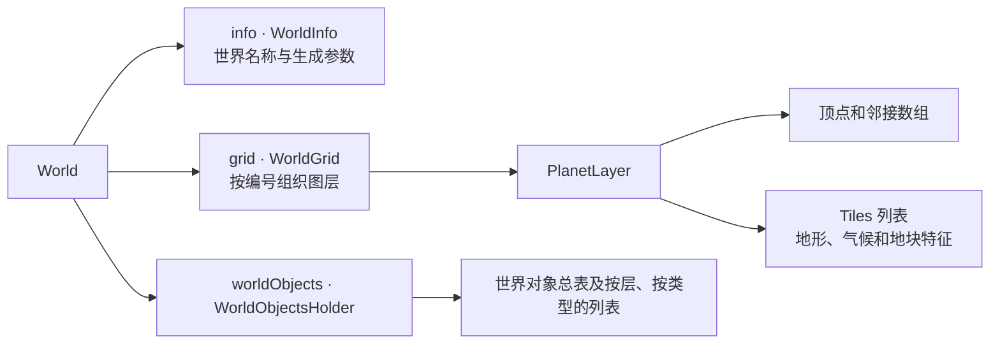
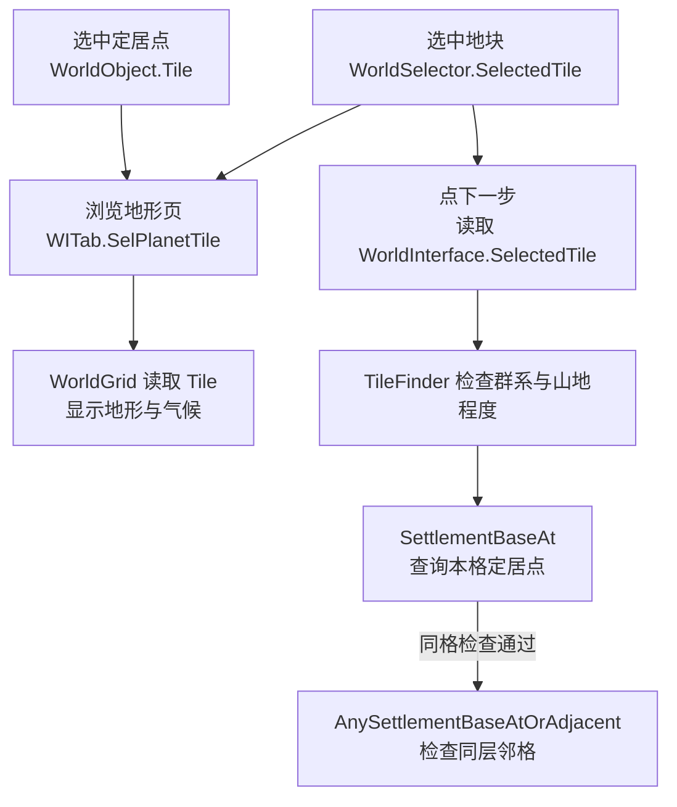
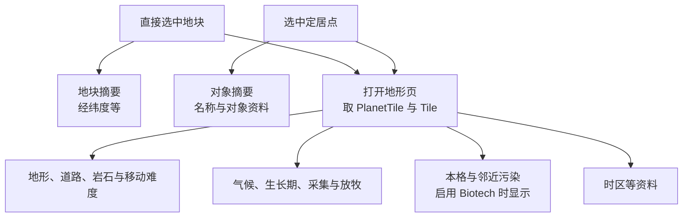

# 世界数据的存储与查询

发布版 v1.0 · 2026-11-20

点中世界地图上的一格，玩家可以查看降雨、岩石和生长期。点中同一格的定居点，也可以打开「地形」页读到这些资料。开局时点「下一步」，选址页则用当前选中的地块查询本格和邻格的定居点。

本文依据 RimWorld 1.7.4982 rev1280 的源码与原版 XML，沿地表第 42 格追踪这些查询，以及读档后这格的降雨和定居点怎样恢复。

## 常用查询方法

`tile` 是 `PlanetTile`，由图层编号与层内地块编号组成。`map.Tile` 和 `worldObject.Tile` 都能提供这个位置。

| 想查什么 | 调用或读取方式 | 得到什么 | 详解 |
| --- | --- | --- | --- |
| 一格的地形和气候 | `Find.WorldGrid[tile]` | 返回可读取海拔、主群系、降雨等字段的 `Tile`。 | [2.2](#22-先找图层再按编号取地块) |
| 地块编号是否在范围内 | `Find.WorldGrid.InBounds(tile)` | 在图层已知存在时，检查编号是否在该层范围内。 | [2.2](#22-先找图层再按编号取地块) |
| 同一图层的邻格 | `Find.WorldGrid.GetTileNeighbors(tile, neighbors)` | 清空并填入调用方提供的 `List<PlanetTile>`。 | [2.4](#24-读取并比较同层邻格) |
| 地块中心的经纬度 | `Find.WorldGrid.LongLatOf(tile)` | 返回 `Vector2`，`x` 为经度，`y` 为纬度。 | [4.1](#41-从坐标地形和道路读出地块概况) |
| 本格的定居点 | `Find.WorldObjects.SettlementBaseAt(tile)` | 返回找到的 `Settlement`，没有则返回 `null`。 | [3.2](#32-确认落点时检查本格与邻格的定居点) |
| 本格或邻格是否有定居点 | `Find.WorldObjects.AnySettlementBaseAtOrAdjacent(tile)` | 返回 `bool`，只检查同一图层。 | [3.2](#32-确认落点时检查本格与邻格的定居点) |
| 本格的某类世界对象 | `Find.WorldObjects.WorldObjectAt<Caravan>(tile)` | 以远行队为例，返回第一个匹配对象，没有则返回 `null`。 | [3.3](#33-查同一格上的其他世界对象) |
| 本格的天然岩石种类 | `Find.World.NaturalRockTypesIn(tile)` | 返回岩石的 `ThingDef` 序列。 | [4.1](#岩石种类怎样抽取) |
| 本格当前的季节气温 | `GenTemperature.GetTemperatureFromSeasonAtTile(GenTicks.TicksAbs, tile)` | 返回平均温度加上当前的季节偏移。 | [4.2](#42-从季节温度算出生长期) |
| 地形页的生长期 | `Zone_Growing.GrowingQuadrumsDescription(tile)` | 返回「全年」、`40/60` 天等显示文本。 | [4.2](#42-从季节温度算出生长期) |
| 本格现在能否放牧 | `VirtualPlantsUtility.EnvironmentAllowsEatingVirtualPlantsNowAt(tile)` | 按主群系的植被条件和当前季节气温返回 `bool`。 | [4.3](#43-植被怎样影响放牧和远行采集) |
| 本格和邻近污染 | `Find.WorldGrid[tile].pollution`、`WorldPollutionUtility.CalculateNearbyPollutionScore(tile)` | 分别返回本格的污染比例和按距离加权的污染得分。 | [4.4](#44-分别读取本格污染与邻近污染) |

## 一、`World` 怎样组织世界数据

`World` 持有三个常用入口。`WorldInfo` 记录种子、覆盖率、气温与降雨档位等生成设置。`WorldGrid` 按编号管理各层的地块和几何数据。`WorldObjectsHolder` 则保存定居点、远行队等世界对象。



### 1.1 `World` 保存各部分的入口

生成世界时，`Grids` 步骤建立网格。`ConstructComponents()` 创建世界对象容器、派系管理器等对象。进入游戏后，`Find.WorldGrid` 和 `Find.WorldObjects` 就从当前的 `World` 取得这两个入口。种子和降雨档位留在 `WorldInfo`，逐格生成的实际降雨值则写入各个地块。

### 1.2 `WorldGrid` 按编号保存图层

`WorldGrid` 把图层放在以整数编号为键的字典里。新图层按 `PlanetLayerDef.layerType` 创建，注册时取得自己的编号。例如，地表的 `SurfaceLayer` 与 Odyssey 的 `OrbitLayer` 各有一份地块列表，两层的第 42 格都可以存在。

### 1.3 `PlanetLayer` 保存地块列表和几何数组

`PlanetLayer.Tiles` 按层内编号排列。一层建立好几何网格时，顶点、邻格和地块总数就已经确定，生成器随后才向 `Tiles` 填入各格的数据。顶点和邻格各用一组偏移量与一组连续数组保存。偏移量给出每格从哪里开始读，第 [2.4](#24-读取并比较同层邻格) 节用第 42 格的邻接记录演示。

### 1.4 `Tile` 和 `SurfaceTile` 各保存什么

一份 `Tile` 记录保存这格的位置、海拔、山地程度、温度和降雨。主群系与地块特征分别引用 `BiomeDef` 和 `TileMutatorDef`。地表使用子类 `SurfaceTile`，还会记录通往邻格的道路和河段。一条道路建在 A、B 两格之间时，A 记下通向 B 的连接，B 也记下通向 A 的连接。地形页读取这些连接前会检查群系是否允许道路或河流。

### 1.5 定居点与远行队放在世界对象列表里

每个 `WorldObject` 有自己的 `ID`、`WorldObjectDef` 和位置。同一格的定居点与远行队可以持有相同的 `PlanetTile`。对象加入世界时，`WorldObjectsHolder.Add()` 先把它放进总列表，再用 `AddToCache()` 把同一个对象放进对应图层及类型的列表。移除对象时也会更新这些列表。读档时，容器从恢复的总列表重新建立它们。

### 1.6 同一个位置还关联哪些数据

| 数据 | 怎样由地块取得 |
| --- | --- |
| Odyssey 地标 | `WorldLandmarks` 以 `PlanetTile` 为键查找地标。 |
| 有名字的大片地貌 | 属于同一区域的各格通过 `Tile.feature` 引用同一份 `WorldFeature`。 |
| 世界寻路代价 | `WorldPathGrid` 为各层维护代价数组，以层内编号读取其中一项。 |

## 二、通过 `PlanetTile` 定位图层和地块

假设根地表编号为 `0`，轨道层编号为 `1`。查第 42 格时，图层编号先选出要查的那一层，层内编号再定位这层的地块。

### 2.1 用两个编号表示一个世界位置

`PlanetTile` 是一个只读结构体。构造函数的第一个参数 `tileId` 是层内编号，第二个参数 `layerId` 是层编号。

```csharp
public PlanetTile(int tileId, int layerId)
{
    this.tileId = tileId;
    this.layerId = layerId;
}
```

开发者模式下，地形页把 `new PlanetTile(42, 0)` 显示为 `42,0`。只传一个整数 `42` 时，单参数构造函数使用层编号 `0`。转成 `int` 则只保留 `tileId`，所以把 `42,1` 转成整数再转回，会得到 `42,0`。

### 2.2 先找图层，再按编号取地块

`PlanetTile.Layer` 用层编号查 `WorldGrid.PlanetLayers`，负层编号直接取得根地表。得到图层后，下面的索引器用位置中的 `tileId` 取出那格的记录。

```csharp
public Tile this[PlanetTile tile]
{
    get
    {
        return tile.Layer.Tiles[tile.tileId];
    }
}
```

`Find.WorldGrid[42]` 使用整数索引器，直接取地表。`Find.WorldGrid[new PlanetTile(42, 0)]` 通过层编号 `0` 取地块。调用带 `PlanetTile` 的索引器前，要有已登记的图层和范围内的地块编号。比如某层只有 100 格，编号 120 仍满足 `Valid` 的非负条件，`InBounds()` 才会按该层总格数查出越界。

### 2.3 比较两个位置是否指向同一格

`Equals()` 先比层内编号，再比图层。层编号相同即通过。层编号有差异时，如果两者都表示根地表，也会视为同一格。因此 `42,-1` 与 `42,0` 相等，而 `42,1` 指向轨道上的另一格。`GetHashCode()` 同样把根地表的两种写法归一，地标字典可以据此查到同一条记录。

### 2.4 读取并比较同层邻格

`GetTileNeighbors()` 把查询交给位置所在的层。图层先查当前格和下一格的偏移量，再把这段邻接记录填进调用方的列表。假设第 42 格的偏移量是 250，第 43 格的是 256，第 42 格的邻格就存于数组的第 250 至 255 项。查询层内最后一格时，用整个邻接数组的长度作为结束位置。

比较同层内的两个位置时，`IsNeighborOrSame()` 先看编号是否相同，再到第一格的邻接记录里找第二格。

## 三、用同一个位置查地形和定居点

查看地形时，直接选中第 42 格和选中这格上的定居点都能取得 `42,0`。点「下一步」确认落点时，选址页从当前选中的地块取得位置，再检查它是否适合建基地。



### 3.1 地形页从当前选择取得位置

`WITab` 是世界地图详情页的基类。`SelObject` 取得单个选中的世界对象，`SelPlanetTile` 从该对象取得位置，或在只有地块选择时读取 `SelectedTile`。随后 `SelTile` 把这个位置交给 `WorldGrid` 索引器。

```csharp
protected PlanetTile SelPlanetTile
{
    get
    {
        WorldObject selObject = this.SelObject;
        if (selObject == null)
        {
            return Find.WorldSelector.SelectedTile;
        }
        return selObject.Tile;
    }
}
```

原版定居点有「地形」页。位于根地表时，直接点中一格或点中该格的定居点，都可以打开这页，读到相同的海拔、降雨等数据。

### 3.2 确认落点时检查本格与邻格的定居点

`Page_SelectStartingSite.CanDoNext()` 读取 `WorldInterface.SelectedTile`，再将有效位置交给 `TileFinder.IsValidTileForNewSettlement()`。单独点中定居点会清除地块选择，此时玩家要重新选择地块。

`TileFinder` 先检查群系和山地程度，通过后用 `SettlementBaseAt(tile)` 在 `settlementBases` 列表中查找本格的定居点。普通开局若发现本格已被占用，就按对象的派系给出提示。若本格通过，才用 `AnySettlementBaseAtOrAdjacent()` 检查附近。下面的 `tile` 是候选位置，`wo` 把找到的定居点交还给选址检查。

```csharp
public bool AnySettlementBaseAtOrAdjacent(PlanetTile tile, out WorldObject wo)
{
    WorldGrid worldGrid = Find.WorldGrid;
    for (int i = 0; i < this.settlementBases.Count; i++)
    {
        Settlement settlement = this.settlementBases[i];
        if (settlement.Tile.Layer == tile.Layer && worldGrid.IsNeighborOrSame(settlement.Tile, tile))
        {
            wo = settlement;
            return true;
        }
    }
    wo = null;
    return false;
}
```

例如，地表第 42 格空着，但相邻的第 47 格已有定居点。同格查询返回 `null`，邻格查询返回 `true`，选址页就会提示附近已有派系基地。若定居点位于轨道第 47 格，图层比较会跳过它。通过这两项后，选址还会检查该格是否有和平会谈地点等情况。完整的开局顺序见[世界生成主章](release.md)。

### 3.3 查同一格上的其他世界对象

要找停在第 42 格的远行队，可以用 `WorldObjectAt<Caravan>(tile)`。它从总列表依次比较对象的位置和 C# 类型，返回第一个匹配的对象。按 `WorldObjectDef` 查询的重载也扫描总列表，比较的是位置与 Def。`SiteAt()` 和 `MapParentAt()` 则在各自的类型列表里查找。

## 四、在世界地图上能查到什么

直接选中地块时，摘要显示地块的标题与经纬度，标题优先使用 Odyssey 地标名，其次使用主群系名。选中定居点时，摘要显示对象名称与资料。两种选择都可以打开「地形」页，沿第三节的查询入口读取同一格。



### 4.1 从坐标、地形和道路读出地块概况

`LongLatOf()` 取这一格的顶点坐标平均值作为中心，再换算出经纬度。摘要按纬度、经度的顺序显示。地形页末尾的时区用经度除以 15 再取整。

| 玩家看到的信息 | 游戏怎样取得它 |
| --- | --- |
| 地形、海拔 | 地形通常取自 `hilliness`，也可使用地块特征提供的名称。海拔直接取自 `elevation`。 |
| 道路、河流 | 道路名称去重后列出。河流从相连河段中选取维持流量门槛 `degradeThreshold` 最高的类型。 |
| 地标、地图元素 | 启用 Odyssey 时可显示地标名。地图元素按 `displayPriority` 从高到低排列，悬停可以看说明。 |

#### 岩石种类怎样抽取

群系允许建基地时，地形页通过 `NaturalRockTypesIn()` 显示岩石。群系指定了 `forceRockTypes` 就采用那份列表，否则从当前群系允许的天然岩石中抽取，目标为两至三种。随机序列以地块位置的哈希值为种子，同一次游戏里反复查看这一格会得到同样的组合。

#### 移动难度怎样算进道路

可通行地块的基础难度由群系、山地和当前冬季修正相加得到。地形页再乘道路系数。它优先选通向可通行邻格、系数小于 1 的道路，取其中系数最低的一条。没有这样的道路时，采用第一个可通行邻格的方向。该方向没有道路就用系数 1。

### 4.2 从季节温度算出生长期

「平均温度」直接取 `Tile.temperature`。括号内的最低和最高温度来自对全年季节气温的取样。季节气温以地块的平均温度为基准，叠加随时节变化的偏移。纬度越高，季节波动一般越大，南北半球的变化相差半年。

「生长期」把一年分成 12 个五日段。游戏分别对各段取样求平均，将段均温在 `6–42°C` 范围内的时段计入生长期，包含两端。每通过一段就计 5 天，通过 12 段时显示「全年」。

例如，两格的平均温度都是 `15°C`，仅纬度不同，地形页就可能显示以下结果。

| 地块 | 括号中的季节温度范围 | 生长期 |
| --- | --- | --- |
| 赤道 | 约 `12–18°C` | 12 段通过，显示「全年」 |
| 北纬 `45°` | 约 `−5–35°C` | 8 段通过，显示 `40/60` 天 |

降雨量直接取 `Tile.rainfall`，按整数毫米显示。气候篇算例中的降雨量是 2800，因此地形页显示 `2800mm`。[气候与地形规则](01-climate-terrain-rules-release.md)

### 4.3 植被怎样影响放牧和远行采集

「远行采集量」用群系的 `forageability` 和 `foragedFood` 显示采集百分比及食物。两项条件是采集系数大于零且定义了食物，其余情况显示 `0%`。「当前可否放牧」要求主群系有可放牧植被，且当前时刻的季节气温至少为 `0°C`。例如冬末回暖到零度时，支持放牧的地块就可能先显示「是」，面板仍按五日段均温统计生长期。

### 4.4 分别读取本格污染与邻近污染

启用 Biotech 时，地形页把 `Tile.pollution` 直接显示为本格污染百分比。邻近污染则从本格开始沿邻格扩展，遍历上限按四层邻格的格数估算。每到一格，就将它的污染值乘以距离权重再累加。相隔零至两步时权重为 1，从第三步起为 0.5。

例如，本格污染 `10%`，相隔三步的一格污染 `60%`，其余访问到的格子污染为零。邻近污染得分就是 `0.1 + 0.6 × 0.5 = 0.4`，面板两行分别显示 `10%` 和 `0.40`。

## 五、存档怎样恢复地块与定居点

假设根地表第 42 格的降雨量为 `2800.4` 毫米，上面有一座定居点。保存时，降雨随图层写入各格的字段数据，定居点随世界对象总列表写入。读档时，游戏先把图层和地块恢复出来，再读入对象并重建查询列表。

### 5.1 将地块字段按编号写入存档

`World.ExposeData()` 先处理 `WorldInfo` 和 `WorldGrid`。网格保存各层的设置，例如图层编号、细分次数和覆盖角度，再由各层按地块编号分别打包海拔、山地程度、降雨等字段。

以下是地表打包降雨的代码。`base.TilesCount` 是地块数，`i` 是写入的层内编号。每格的降雨取整后限制在 `ushort` 的范围内。下标 42 的 `2800.4` 因而变成 `2800`，随降雨数组写入存档。

```csharp
this.tileRainfall = DataSerializeUtility.SerializeUshort(base.TilesCount, (int i) => (ushort)Mathf.Clamp(Mathf.RoundToInt(this.tiles[i].rainfall), 0, 65535));
```

### 5.2 先恢复图层，再把字段填回各格

`PlanetLayer` 先读本层设置并重建顶点和邻接关系，再取出存档里的字段数组。`RawDataToTiles()` 按重建的格数准备 `Tiles` 列表，将群系、降雨等字段按编号填回。下面的 `data` 是从数组读出的整数毫米数，`i` 是它对应的地块编号。

```csharp
DataSerializeUtility.LoadUshort(this.tileRainfall, base.TilesCount, delegate(int i, ushort data)
{
    this.tiles[i].rainfall = (float)data;
});
```

### 5.3 读取定居点并重建查询列表

存档时，世界对象容器逐个保存可存档对象，定居点把自己的 `ID` 和 `PlanetTile` 一起写入。世界网格读完后，游戏才读取世界对象总列表。`Recache()` 逐个检查读回的对象，把定居点重新登记到对应图层与类型的列表。

读档后，把 `new PlanetTile(42, 0)` 赋给 `tile`。`Find.WorldGrid[tile].rainfall` 返回 `2800`，地形页仍显示 `2800mm`。`Find.WorldObjects.SettlementBaseAt(tile)` 则在重建的定居点列表中找到这格上的定居点。

[完整解析版](02-world-data-storage-query.md) · [世界生成主章](release.md) · [气候与地形规则](01-climate-terrain-rules-release.md) · [第七章目录](README.md)
