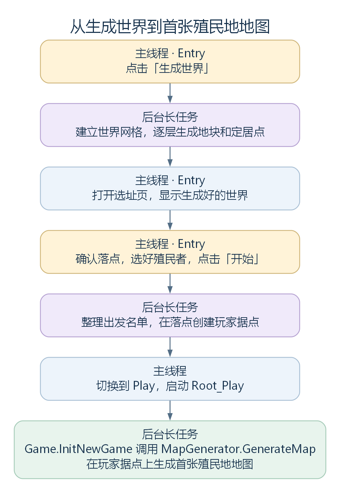
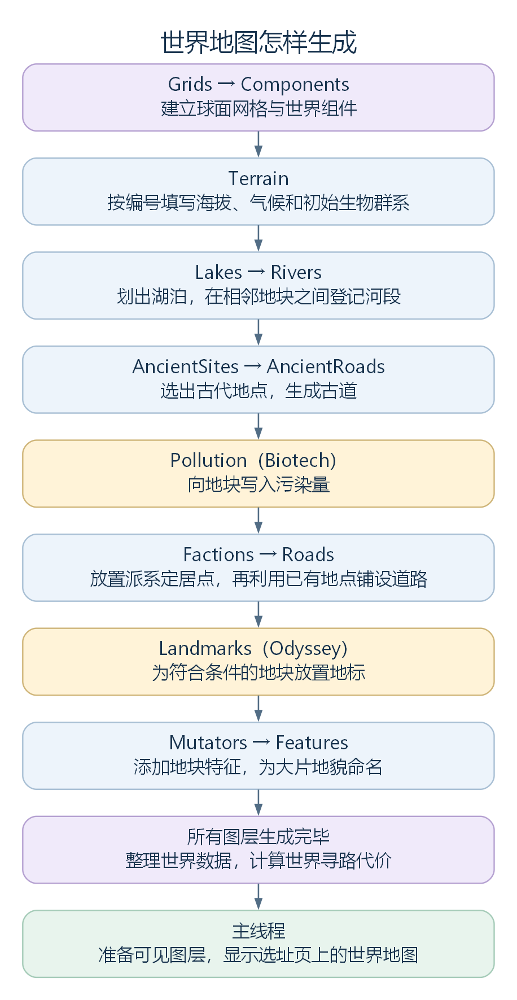

# 从种子到落点：RimWorld 怎样创建世界

整合草稿 v0.1，2026-11-16。依据 RimWorld 1.7.4982 rev1280 的源码和原版 XML，沿普通手动选址的开局展开。 片段内的中文注释由本文补写。

点击「生成世界」之后，玩家还没选定殖民地，就已经能在世界地图上看到不同地块的地形、气候和各派系的定居点。生成器是怎样把种子和几项设置变成这些数据的？游戏又怎样把玩家点中的位置交给开局地图？

## 世界生成总览



[SVG](../../figures/world-generation-overview.svg) · [图源](../../figures/world-generation-overview.dot)

这段流程可以沿一个位置读到底。生成时，`PlanetTile` 指明正在处理哪一格。选址时，游戏用它查询地形与定居点。开始游戏时，同一个位置被写入玩家据点，成为后续生成殖民地地图的依据。

地块的计算规则见[气候与地形规则](01-climate-terrain-rules-draft.md)，地块和定居点怎样查询、怎样随存档恢复见[世界数据的存储与查询](02-world-data-storage-query-draft.md)。

## 一、把世界设置交给生成任务

确认剧本时，`Page_SelectScenario` 已经建立了 `Current.Game` 和其中的 `GameInitData`。后者保存开局期间使用的数据，比如起始地点和候选殖民者。玩家选择叙事者后，进入 `Page_CreateWorldParams`。对于手动选址的剧本，系统已把 `Page_SelectStartingSite` 接在它的后面。

世界设置暂存在当前页面的字段里。输入种子会写入 `seedString`，选择 30% 覆盖率会把 `planetCoverage` 设为 `0.3f`。降雨和气温滑杆各记下一个档位，派系列表 `factions` 里的元素则是 `FactionDef`。生成时，这些值一并交给 `WorldGenerator.GenerateWorld`。

点击「生成世界」时，页面的按钮处理先调用 `CanDoNext()`。通常只有这个方法返回 `true` 才马上翻页。这里的重写先把生成函数加入长任务队列，再返回 `false`，让页面留到任务完成时再切换。

下面是 `Page_CreateWorldParams.CanDoNext()`。`this.next` 是剧本接在参数页后面的页面。传给 `QueueLongEvent` 的 `"GeneratingWorld"` 是任务提示的翻译键，其后的 `true` 对应 `doAsynchronously`，表示任务主体在后台线程执行。

```csharp
protected override bool CanDoNext()
{
    // 沿用通用页面的前进检查，允许继续时才登记生成任务。
    if (!base.CanDoNext())
    {
        return false;
    }
    // 把生成工作交给异步长任务，任务主体由后台线程执行。
    LongEventHandler.QueueLongEvent(delegate
    {
        // 先清掉旧世界和旧落点，再把生成结果接到当前 Game。
        Find.GameInitData.ResetWorldRelatedMapInitData();
        Current.Game.World = WorldGenerator.GenerateWorld(this.planetCoverage, this.seedString, this.rainfall, this.temperature, this.population, this.landmarkDensity, this.factions, this.pollution);
        // 把界面操作留给主线程，在后台生成结束后执行。
        LongEventHandler.ExecuteWhenFinished(delegate
        {
            if (this.next != null)
            {
                Find.WindowStack.Add(this.next);
            }
            // 登记资源清理，重建可见的世界图层，再关闭参数页。
            MemoryUtility.UnloadUnusedUnityAssets();
            Find.World.renderer.RegenerateAllLayersNow();
            this.Close(true);
        });
    }, "GeneratingWorld", true, null, true, false, null);
    // 这次按钮调用返回 false，由上面登记的函数打开下一页。
    return false;
}
```

后台线程先清空上一个世界及其相关的开局数据，包括候选殖民者、玩家派系引用和选过的落点。这一步也覆盖了玩家从选址页返回、改种子再生成的情况。随后才开始建立新的 `World`。

源码位置见 `RimWorld.Page_SelectScenario.cs:215`、`RimWorld.Scenario.cs:221`、`RimWorld.Page.cs:77`、`RimWorld.Page_CreateWorldParams.cs:187` 和 `Verse.GameInitData.cs:30`。任务的执行方式见[长任务与线程协作](../05-threads/article.md)。

## 二、建立世界和生成步骤的运行环境

生成器先用 `Rand.PushState()` 保存原有的随机状态，再把 `seedString` 经 `GenText.StableStringHash` 转成整数 `seedFromSeedString`，作为这次生成的初始种子。然后它把新的 `World` 暂存在 `Current.CreatingWorld`。刚才清空了 `Current.Game.World`，此时调用 `Find.World` 会取得正在建立的世界。页面参数写入 `WorldInfo`，随后执行的生成步骤可以从这里读到它们。

| `World` 的字段 | 后续从这里取什么 |
| --- | --- |
| `info`，类型为 `WorldInfo` | 世界名称、种子和生成参数，例如整体降雨档位。 |
| `grid`，类型为 `WorldGrid` | 星球的各层，以及层内的地块和网格数据。 |
| `worldObjects`，类型为 `WorldObjectsHolder` | 登记在世界地图上的对象，例如定居点。 |

### 2.1 GenerateWorld 的完整方法

第一节介绍的八项设置就是下面的参数。`seedFromSeedString` 是字符串转换出的随机种子。`Find.WorldGrid.PlanetLayers` 用层编号作键，因而遍历时 `keyValuePair.Key` 是层编号，解构后得到的 `planetLayer` 和 `planetLayer2` 引用同一层。方法结束前，`creatingWorld` 保存新世界的引用，`finally` 清空 `Current.CreatingWorld` 后仍可返回这个世界。

下面保留反编译文件的完整方法，统一缩进。`DeepProfiler` 记录执行时间，`DefaultInterpolatedStringHandler` 在发现空层时组装日志文字。

```csharp
public static World GenerateWorld(float planetCoverage, string seedString, OverallRainfall overallRainfall, OverallTemperature overallTemperature, OverallPopulation population, LandmarkDensity landmarkDensity, List<FactionDef> factions = null, float pollution = 0f)
{
    // 开始计时，保存原有的随机状态，再用世界种子开启本次生成。
    DeepProfiler.Start("GenerateWorld");
    Rand.PushState();
    int seedFromSeedString = WorldGenerator.GetSeedFromSeedString(seedString);
    Rand.Seed = seedFromSeedString;
    World creatingWorld;
    try
    {
        // 把新世界放在临时入口，让后续步骤能通过 Find.World 访问它。
        Current.CreatingWorld = new World
        {
            // 把参数页的设置写入 WorldInfo，并用当前随机序列生成世界名称。
            info = 
            {
                seedString = seedString,
                planetCoverage = planetCoverage,
                overallRainfall = overallRainfall,
                overallTemperature = overallTemperature,
                overallPopulation = population,
                landmarkDensity = landmarkDensity,
                name = NameGenerator.GenerateName(RulePackDefOf.NamerWorld, null, false, null, null, null),
                factions = factions,
                pollution = pollution
            }
        };
        // 按准备步骤建立网格和世界组件，每个步骤从自己的种子开始。
        foreach (GameSetupStepDef gameSetupStepDef in WorldGenerator.GameSetupStepsInOrder)
        {
            Rand.Seed = Gen.HashCombineInt(seedFromSeedString, gameSetupStepDef.setupStep.SeedPart);
            gameSetupStepDef.setupStep.GenerateFresh();
        }
        // 按层编号依次生成：每层使用自己的步骤列表填入内容。
        foreach (KeyValuePair<int, PlanetLayer> keyValuePair in Find.WorldGrid.PlanetLayers.OrderBy<KeyValuePair<int, PlanetLayer>, int>((KeyValuePair<int, PlanetLayer> x) => x.Key))
        {
            int num;
            PlanetLayer planetLayer;
            keyValuePair.Deconstruct(out num, out planetLayer);
            PlanetLayer planetLayer2 = planetLayer;
            WorldGenerator.GeneratePlanetLayer(planetLayer2, seedString, seedFromSeedString);
            // 生成完这一层后，如果没有留下地块，就记录警告。
            if (planetLayer2.Tiles.Count == 0)
            {
                DefaultInterpolatedStringHandler defaultInterpolatedStringHandler = new DefaultInterpolatedStringHandler(112, 1);
                defaultInterpolatedStringHandler.AppendLiteral("No tiles on layer ");
                defaultInterpolatedStringHandler.AppendFormatted<PlanetLayer>(planetLayer2);
                defaultInterpolatedStringHandler.AppendLiteral(", layer should have a world gen step worker which initializes tiles such as WorldGenStep_Tiles");
                Log.Warning(defaultInterpolatedStringHandler.ToStringAndClear());
            }
        }
        // 回到世界种子，从这个随机起点执行生成后的整理和剧本处理。
        Rand.Seed = seedFromSeedString;
        // 处理空层、初始化世界组件，再通知各剧本部分世界已生成。
        Current.CreatingWorld.grid.StandardizeTileData();
        Current.CreatingWorld.FinalizeInit(false);
        Find.Scenario.PostWorldGenerate();
        // 未启用 Ideology 时，直接让剧本准备候选殖民者等开局数据。
        if (!ModsConfig.IdeologyActive)
        {
            Find.Scenario.PostIdeoChosen();
        }
        // 先保存结果，临时入口清空后仍能将这个 World 返回给调用者。
        creatingWorld = Current.CreatingWorld;
    }
    finally
    {
        // 离开 try 时恢复原有的随机序列，结束计时并清空临时入口。
        Rand.PopState();
        DeepProfiler.End();
        Current.CreatingWorld = null;
    }
    return creatingWorld;
}
```

读这个方法可以沿两次遍历走。第一轮执行全局准备步骤，先让世界有网格、层和管理对象。第二轮遍历这些已经建立的层，让每一层按自己的 Def 列表填入内容。地块和定居点的生成进入第三节，`StandardizeTileData()` 之后的收尾进入第四节。

### 2.2 先准备网格和世界组件

`GenerateWorld` 先执行 `GameSetupStepDef`。例如，`Grids` 步骤创建 `WorldGrid` 和 `WorldPathGrid`，前者组织地块，后者存放世界寻路使用的代价数据。`WorldGrid` 根据剧本中的 `ScenPart_PlanetLayer` 创建所需的层，其中普通开局的地表层负责装入选址所用的地块。随后的 `Components` 步骤建立 `WorldObjectsHolder`、派系管理器和世界界面等对象。

`GameSetupStep_Grids.GenerateFresh()` 里给当前世界挂上网格和寻路网格。`ExecuteWhenFinished` 负责登记清理旧的地形碰撞缓存，接着生成步骤本身调用 `GenerateFreshWorld()`。

```csharp
public override void GenerateFresh()
{
    // 登记清理旧世界的地形碰撞缓存，任务完成后执行。
    LongEventHandler.ExecuteWhenFinished(new Action(WorldTerrainColliderManager.ClearCache));
    // 为当前世界建立地块网格与世界寻路网格。
    Find.World.grid = new WorldGrid();
    Find.World.pathGrid = new WorldPathGrid();
    // 清除上次生成留下的噪声调试数据，再开始建立新世界的网格。
    NoiseDebugUI.ClearPlanetNoises();
    Find.WorldGrid.GenerateFreshWorld();
}
```

`WorldGrid.GenerateFreshWorld()` 先计算地表生成中心和角度，再建立剧本需要的层。

```csharp
public void GenerateFreshWorld()
{
    // 把覆盖率换算成生成中心和角度，再用它们创建剧本指定的世界层。
    this.CalculateViewCenterAndAngle();
    this.CreateRequiredLayers();
}
```

每层的 `PlanetLayer` 既保存它的几何网格，也持有用于装入地块对象的 `Tiles`。网格先确定地块的位置和数量，降雨、生物群系等内容将在逐层生成时写进去。

### 2.3 覆盖率怎样确定地表网格的范围

`WorldGrid.GenerateFreshWorld()` 先调用 `CalculateViewCenterAndAngle()`，确定地表的生成中心和角度，随后创建世界层。这个方法把设置页的覆盖率转换为 `surfaceViewAngle`，也就是从生成中心量出去的角度上限。`surfaceViewCenter` 是生成中心方向，`num` 是把初始方向 `Vector3.back` 绕横轴旋转的角度。

```csharp
private void CalculateViewCenterAndAngle()
{
    // 把覆盖率换算成从生成中心向外量的角度上限。
    this.surfaceViewAngle = Find.World.PlanetCoverage * 180f;
    // 以 Vector3.back 为初始方向，根据覆盖角度计算中心的旋转量。
    this.surfaceViewCenter = Vector3.back;
    float num = 45f;
    if (this.surfaceViewAngle > 45f)
    {
        num = Mathf.Max(90f - this.surfaceViewAngle, 0f);
    }
    // 绕 Vector3.right 旋转，得到地表实际使用的生成中心方向。
    this.surfaceViewCenter = Quaternion.AngleAxis(num, Vector3.right) * this.surfaceViewCenter;
}
```

| 设置页的覆盖率 | 传给地表层的角度上限 |
| --- | --- |
| 30% | 54° |
| 50% | 90° |
| 100% | 180° |

地表层建立时，`PlanetLayer.InitializeLayer()` 从一个二十面体开始，在生成范围周围选择所需的三角面，再反复细分。最后一次细分沿三角网格构造五边形或六边形地块。对于部分覆盖，`ShouldDiscardGeneratedTile()` 用地块顶点的平均位置判断地块有没有超出指定角度。角度达到 180° 时，`VisibleForWorldgen()` 会接受整个球面上的地块。

下面节选 `InitializeLayer()` 里建立几何网格的部分。`tmp_verts` 和 `tmp_tris` 暂存顶点与三角面，`flag` 在最后一次细分时为 `true`，让 `Subdivide` 生成地块多边形。`verts` 和 `tileIDToVerts_offsets` 保存生成后的顶点和各地块的顶点起始下标。

```csharp
// 先建立二十面体的粗网格，保留生成范围周围所需的三角面。
IcosahedronGenerator.GenerateIcosahedron(PlanetLayer.tmp_verts, PlanetLayer.tmp_tris, this.Radius, this.viewCenter, this.viewAngle);
// 反复细分粗网格，最后一轮把网格转换成地块多边形。
for (int i = 0; i < this.subdivisions + 1; i++)
{
    bool flag = i == this.subdivisions;
    this.Subdivide(flag);
}
// 把生成的顶点和每格的顶点起始下标保存到层中。
this.verts = NativeArrayUtility.GetNativeArrayCopy<Vector3>(PlanetLayer.tmp_generatedVerts, Allocator.Persistent, false);
this.tileIDToVerts_offsets = NativeArrayUtility.GetNativeArrayCopy<int>(PlanetLayer.tmp_generatedVertOffsets, Allocator.Persistent, false);
// 用地块共用的边登记邻格，后续选址和寻路都可查询。
this.CalculateTileNeighbors();
```

保留下来的地块按生成次序取得层内编号。`CalculateTileNeighbors()` 依次检查每块地的边。如果另一格同时使用一条边的两个顶点，就把它登记为邻格。到这一步，代码已经能回答「有多少格」「这格在哪里」「它和哪些格相邻」，随后 `Terrain` 才会按编号往这些格里写入地形和气候。

这一节的源码位置见 `RimWorld.Planet.WorldGrid.cs:194`、`:234`、`:846`、`RimWorld.Planet.IcosahedronGenerator.cs:11`、`:43`、`RimWorld.Planet.PlanetLayer.cs:445`、`:594`、`:608` 和 `RimWorld.MeshUtility.cs:83`。

### 2.4 挑选生成步骤，为每一步设定随机序列

入口的 `GetSeedFromSeedString()` 直接返回 `GenText.StableStringHash(seedString)`。在下面这个方法里，`str` 是传入的种子字符串，`num` 从 23 开始，按字符依次更新，最后成为用于生成的整数种子。

```csharp
public static int StableStringHash(string str)
{
    // 空引用对应种子 0。
    if (str == null)
    {
        return 0;
    }
    // 从固定初始值开始，按原顺序把字符编码累积到整数种子里。
    int num = 23;
    int length = str.Length;
    for (int i = 0; i < length; i++)
    {
        num = num * 31 + (int)str[i];
    }
    return num;
}
```

准备步骤由 `GameSetupStepsInOrder` 提供。`x` 是正在排序的 `GameSetupStepDef`，按 Def 的 `order` 和 `index` 排序后缓存起来。完整方法的第一轮遍历会调用每个 Def 中 `setupStep.GenerateFresh()`。

```csharp
private static List<GameSetupStepDef> GameSetupStepsInOrder
{
    get
    {
        List<GameSetupStepDef> list;
        // 首次使用时读取已加载的准备步骤 Def，按 order、index 排序后缓存。
        if ((list = WorldGenerator.cachedGenSteps) == null)
        {
            list = (WorldGenerator.cachedGenSteps = (from x in DefDatabase<GameSetupStepDef>.AllDefs
                orderby x.order, x.index
                select x).ToList<GameSetupStepDef>());
        }
        return list;
    }
}
```

每层的步骤顺序通过该层的 `PlanetLayerDef.GenStepsInOrder` 得到。它把定义的 `worldGenSteps` 按同样的两个字段排序，得到下面的 `genStepsInOrder`。`i` 指向当前步骤，`seed` 是入口算出的世界种子整数，`layer` 是正在生成的层。

下面是 `GeneratePlanetLayer()` 的节选，保留步骤循环、种子赋值及异常处理，省略计时调用，并将反编译后的日志拼接还原为字符串插值。某一步报错时，生成器记录步骤和异常，随后继续执行列表中的下一步。

```csharp
public static void GeneratePlanetLayer(PlanetLayer layer, string seedString, int seed)
{
    // 取当前星球层自己的生成步骤列表，再按列表顺序推进。
    List<WorldGenStepDef> genStepsInOrder = layer.Def.GenStepsInOrder;
    for (int i = 0; i < genStepsInOrder.Count; i++)
    {
        try
        {
            // 混合世界种子与本步骤的 SeedPart，设置随机序列，再让该步骤填写这层的数据。
            Rand.Seed = Gen.HashCombineInt(seed, WorldGenerator.GetSeedPart(genStepsInOrder, i));
            genStepsInOrder[i].worldGenStep.GenerateFresh(seedString, layer);
        }
        // 单步报错时记录步骤和异常，保留后续步骤的执行机会。
        catch (Exception ex)
        {
            Log.Error($"Error in WorldGenStep: {genStepsInOrder[i]}: {ex}");
        }
    }
}
```

分配种子时，`GetSeedPart()` 用 `index` 找当前步骤的 `seedPart`。`num` 统计它之前有几步用了相同的 `SeedPart`，最后将次数加在原值上。

```csharp
private static int GetSeedPart(List<WorldGenStepDef> genSteps, int index)
{
    // 读取当前步骤指定的 SeedPart。
    int seedPart = genSteps[index].worldGenStep.SeedPart;
    int num = 0;
    // 检查同一层里排在前面的步骤，累计使用相同 SeedPart 的次数。
    for (int i = 0; i < index; i++)
    {
        if (genSteps[i].worldGenStep.SeedPart == seedPart)
        {
            num++;
        }
    }
    // 相同 SeedPart 的第一次使用保留原值，后续使用逐次加一。
    return seedPart + num;
}
```

前一步多取几次随机数，下一步依然会从自己算出的种子开始。后一步仍然可以读取前一步写入的数据，例如河流生成会用到地块的山地程度。

源码位置见 `RimWorld.Planet.WorldGenerator.cs:14`、`:30`、`:95`、`:200`、`RimWorld.Planet.WorldGrid.cs:194`、`RimWorld.Planet.GameSetupStep_Grids.cs:21`、`RimWorld.Planet.World.cs:169`、`RimWorld.PlanetLayerDef.cs:99`、`Verse.Find.cs:321`、`Verse.GenText.cs:305` 和 `Verse.Rand.cs:18`、`:513`、`:526`。

## 三、世界地图怎样逐步生成

第二节建好的球面网格给出了每格的位置、形状和邻接关系。接下来 `WorldGenerator.GeneratePlanetLayer()` 按该层的步骤列表填写地图内容。这里沿普通开局的地表层 `Surface` 看。`<worldGenSteps>` 指定这层有哪些步骤，真正的执行顺序来自各步骤 Def 的 `order`。图中标出 DLC 的步骤只在相应 DLC 启用时执行。



[SVG](../../figures/world-map-generation-flow.svg) · [图源](../../figures/world-map-generation-flow.dot)

`Terrain` 先把海拔、气候和初始群系填入 `SurfaceTile`。`Lakes` 将较小的相连海洋水域改成湖泊，`Rivers` 再读取地形与气候，在相邻地块之间登记河段。古道和普通道路的节点来自不同阶段。`AncientRoads` 用 `AncientSites` 事先选出的古代地点，`Roads` 则在 `Factions` 放好定居点后，从已有世界对象和补充地点中选路网节点。

道路生成后，启用 Odyssey 的世界会继续选地标。`Mutators` 根据地貌、河段、地标等条件补充每格的特征，最后 `Features` 识别可在世界地图上显示名称的成片地貌。所有图层处理完毕后，第四节接着看游戏怎样整理世界数据，把可见图层交给选址界面。各步骤的参数和实现见[气候与地形规则的地表生成总览](01-climate-terrain-rules-draft.md#地表生成总览)。

### 3.1 地表用 Terrain 步骤建立地块

下面是地表引用的 `Terrain` 定义。它的 `order` 是 `0`，排在地表步骤的最前面。`worldGenStep` 指定了实际执行的类。

```xml
<WorldGenStepDef>
  <!-- 地表定义通过 Terrain 找到这一步，order 决定它在本层的执行顺序。 -->
  <defName>Terrain</defName>
  <order>0</order>
  <!-- Class 指定真正负责生成地形的 C# 类型。 -->
  <worldGenStep Class="WorldGenStep_Terrain"/>
</WorldGenStepDef>
```

地表的 `WorldGenStep_Terrain.GenerateFresh()` 先用当前生成步骤的随机序列准备地形与气候函数，再将逐格遍历交给父类。

下面的 `seed` 是种子字符串，`layer` 是当前地表层。在父类开始遍历之前，这些函数已经准备好，所有地块都会用同一组函数求值。

```csharp
public override void GenerateFresh(string seed, PlanetLayer layer)
{
    // 准备地块采样时使用的海拔、气温偏移、降雨、丘陵和沼泽计算函数。
    this.SetupElevationNoise(layer);
    this.SetupTemperatureOffsetNoise();
    this.SetupRainfallNoise();
    this.SetupHillinessNoise();
    this.SetupSwampinessNoise();
    // 让父类遍历本层的格子。逐格计算仍会调用 Terrain 重写的 GenerateTileFor。
    base.GenerateFresh(seed, layer);
}
```

下面的逐格循环来自父类 `WorldGenStep_Tiles`。`layer` 是正在生成的那一层，`i` 是层内编号，两者共同构成 `PlanetTile`。

```csharp
public override void GenerateFresh(string seed, PlanetLayer layer)
{
    // 重新填充地块列表，按照几何网格确定的数量和编号逐格生成。
    layer.Tiles.Clear();
    for (int i = 0; i < layer.TilesCount; i++)
    {
        // 传入所在层和层内编号，生成该格并按编号顺序放进列表。
        Tile tile = this.GenerateTileFor(new PlanetTile(i, layer), layer);
        layer.Tiles.Add(tile);
    }
}
```

在地表，这里的虚方法进入 `WorldGenStep_Terrain.GenerateTileFor()`。每次调用填好一格的 `SurfaceTile`，写入海拔、山地程度、气温、降雨、沼泽程度和初始生物群系。遍历从编号 `0` 开始，`layer.Tiles` 中的位置和地块编号一一对应。每格的算法和湖泊、河流、道路等后续步骤的完整顺序见[气候与地形规则](01-climate-terrain-rules-draft.md)。

原版定义见 `Core/Defs/PlanetLayerDefs/PlanetLayers.xml` 中的 `Surface` 和 `Core/Defs/WorldGeneration/WorldGenerator.xml` 中的 `Terrain`。遍历和逐格生成见 `RimWorld.Planet.WorldGenStep_Tiles.cs:20` 和 `RimWorld.Planet.WorldGenStep_Terrain.cs:34`、`:174`。

### 3.2 先生成各派系的初始据点，再补足定居点

`Factions` 步骤先用参数页传来的 `FactionDef` 列表创建可以出现在本层的派系。创建可见的非玩家派系时，也会为它放下一个初始定居点。然后才根据地图范围和人口设置决定还需要补多少座定居点。

生成器会从层定义的 `settlementsPer100kTiles` 区间取一个密度，用本层的地块数折算成目标数量。结果还要乘上人口滑杆给出的系数，以及根据本层覆盖角度算出的系数，最后进行随机取整并减去本层已有的定居点。人口普通档的系数为 `1`，高档 `OverallPopulation.High` 为 `2`。这个系数作用于目标数量，随后仍要扣除一开始建好的定居点。

下面节选了补足数量的计算。反编译中的 `CS$<>8__locals1.layer` 是保存到编译器生成对象里的方法参数，这里写回 `layer`。`num` 是角度系数，`randomInRange` 是抽出的密度，`scaleFactor` 是人口系数，`num2` 先保存目标数量，减去已有数量后就是循环要补建的数量。

```csharp
// 算出覆盖角度系数，抽取定居点密度，再取得人口档位的系数。
float num = layer.Def.viewAngleSettlementsFactorCurve.Evaluate(Mathf.Clamp01(layer.ViewAngle / 180f));
float randomInRange = layer.Def.settlementsPer100kTiles.RandomInRange;
float scaleFactor = Find.World.info.overallPopulation.GetScaleFactor();
// 按本层地块数估出目标定居点数，再随机取整。
int num2 = GenMath.RoundRandom((float)layer.TilesCount / 100000f * randomInRange * scaleFactor * num);
// 扣除这个层已有的定居点，得到还要补建的数量。
num2 -= Find.WorldObjects.AllSettlementsOnLayer(layer).Count;
```

每补一座定居点，代码会按 `settlementGenerationWeight` 抽取派系，候选范围是本层允许出现的可见、非玩家、非临时派系。派系确定后，`TileFinder.RandomSettlementTileFor()` 才去找位置。

1. 每轮从该层随机抽取 100 个地块编号。生物群系不能建基地、尚未实现或地形为不可通行山脉的地块，候选权重为零。
2. 其余候选用生物群系的 `settlementSelectionWeight` 加权。派系如果配置了最低气温曲线，就再用当地的最低气温调节权重。
3. 抽中的地块还要通过 `IsValidTileForNewSettlement()`，其中会检查这一格和邻格的已有据点。没有抽到可用位置就再试，最多执行 500 轮。用完次数时，函数记录错误并返回该层编号为 `0` 的地块作为兜底。

确定位置后，生成器给世界对象设置派系、地块和名称，再调用 `Find.WorldObjects.Add(worldObject)`。对象加入世界对象总列表，`Settlement` 还会进入相应的定居点列表。后面的选址检查会把目标 `PlanetTile` 与定居点的 `Tile` 比较。

定居点生成见 `RimWorld.FactionGenerator.cs:24`、`:193`、`RimWorld.Planet.OverallPopulationUtility.cs:24`、`RimWorld.Planet.TileFinder.cs:27`、`:85` 和 `RimWorld.Planet.WorldObjectsHolder.cs:260`、`:315`。候选派系过滤条件见 `Assembly-CSharp.dll` 的 `RimWorld.FactionGenerator/<>c__DisplayClass3_0.<GenerateFactionsIntoWorldLayer>g__Validator|0`。

## 四、生成结束后，主线程打开选址页

各层生成完后，`WorldGrid.StandardizeTileData()` 会对 `Tiles` 为空的层调用 `Standardize()`。随后由 `World.FinalizeInit(false)` 计算世界寻路代价、准备世界环境音并通知世界组件完成初始化。这里的 `fromLoad` 表明此次初始化是否来自读档，新世界传入 `false`。

```csharp
public void FinalizeInit(bool fromLoad)
{
    // 算出各层的通行代价，供世界寻路查询。
    this.pathGrid.RecalculateAllLayersPathCosts();
    // 准备世界地图的环境音，再通知各世界组件完成初始化。
    AmbientSoundManager.EnsureWorldAmbientSoundCreated();
    WorldComponentUtility.FinalizeInit(this, fromLoad);
}
```

接下来 `Scenario.PostWorldGenerate()` 依次调用剧本各部分的同名方法。普通开局中，`ScenPart_PlayerFaction` 在这里创建玩家派系并登记到派系管理器，后续开局准备会从 `GameInitData.playerFaction` 取得它。

```csharp
public override void PostWorldGenerate()
{
    // 用剧本指定的 FactionDef 创建玩家派系，保存给后续开局配置。
    Find.GameInitData.playerFaction = FactionGenerator.NewGeneratedFaction(new FactionGeneratorParms(this.factionDef, default(IdeoGenerationParms), null));
    // 让世界的派系管理器也能查到这个玩家派系。
    Find.FactionManager.Add(Find.GameInitData.playerFaction);
}
```

未启用 Ideology 时，世界生成收尾会接着调用 `Scenario.PostIdeoChosen()`。在「迫降」这样的剧本中，这一步生成候选殖民者，填入 `GameInitData.startingAndOptionalPawns`。启用 Ideology 时，这个方法改在文化形态配置完成后调用。第一节重新生成世界时清空的就是这份候选名单。

生成器在退出前用 `Rand.PopState()` 恢复先前保存的随机状态，清空临时入口 `Current.CreatingWorld`，并返回新世界。第一节的长任务把它写入 `Current.Game.World`，接着登记打开下一页的函数。主线程在 `Root.Update` 中发现后台线程已结束后，执行这段函数。它打开选址页，登记未使用资源的清理工作，重建可见的世界绘制图层，最后关闭参数页。

从这里开始，选址界面和后续游戏都可以通过 `Find.World` 取得已经登记在 `Current.Game` 上的世界。

源码位置见 `RimWorld.Planet.WorldGenerator.cs:75`、`RimWorld.Planet.WorldGrid.cs:950`、`RimWorld.Planet.World.cs:218`、`RimWorld.Scenario.cs:295`、`:304`、`RimWorld.ScenPart_PlayerFaction.cs:55`、`RimWorld.ScenPart_ConfigPage_ConfigureStartingPawnsBase.cs:17`、`RimWorld.Page_ChooseIdeoPreset.cs:433`、`Verse.Root.cs:122`、`Verse.LongEventHandler.cs:305` 和 `RimWorld.Planet.WorldRenderer.cs:143`。

## 五、选中地块后，读取地形并检查落点

### 5.1 选中一格后读取地块信息

普通点击地表时，`WorldSelector` 调用 `GenWorld.MouseTile(false)`。`GenWorld` 把鼠标屏幕坐标转成一条从世界相机出发的射线，用它检查鼠标指到了哪个世界图层的可碰撞表面。命中后，`WorldRenderer` 让对应的绘制图层把命中结果转换为 `PlanetTile`。选择器将这个值存入 `selectedTile`，选址页通过 `WorldInterface.SelectedTile` 读到它。

「地形」页通过 `WITab.SelTile` 把当前位置交给 `WorldGrid`，再从返回的 `Tile` 读取海拔、降雨等数据。面板上的各项读数怎样取得，见[世界数据的存储与查询](02-world-data-storage-query-draft.md#四在世界地图上能查到什么)。

### 5.2 浏览时更新位置，按下一步才确认

选址页在浏览过程中就会更新 `GameInitData.startingTile`。当玩家选中一格时，`DoWindowContents()` 会记下当前地块的位置。点击定居点图标时，`WorldSelector.Select()` 会清掉当前的地块选择，登记选中的对象，页面再取定居点的 `Tile`。因此，浏览时记下的位置既可能来自地块，也可能来自定居点。

按「下一步」时，`CanDoNext()` 重新读取 `WorldInterface.SelectedTile`。只点中了定居点图标时，玩家仍需选中一个地块才能继续。有了有效地块以后，`TileFinder.IsValidTileForNewSettlement()` 检查群系和地形能否定居，再用 `Find.WorldObjects.SettlementBaseAt(tile)` 查这一格是否已有定居点，随后检查邻格等其他条件。

通过检查后，`DoNext()` 将选中的位置保存在 `selTile`，交给 `CheckConfirmSettle()`。出现确认弹窗时，等玩家同意后才将位置写回 `startingTile` 并翻页。没有弹窗时，这两步立即执行。

以下是 `DoNext()` 的等价节选。反编译里的 `this.<>n__0()` 是调用 `Page.DoNext()` 的包装方法，这里写回 `base.DoNext()`。

```csharp
PlanetTile selTile = Find.WorldInterface.SelectedTile;
// 先处理可能出现的选址确认提示，允许继续时才运行这段函数。
SettlementProximityGoodwillUtility.CheckConfirmSettle(selTile, delegate
{
    // 写入最终落点，再接回基类的翻页流程。
    Find.GameInitData.startingTile = selTile;
    base.DoNext();
}, null, null);
```

源码位置见 `RimWorld.GenWorld.cs:13`、`:41`、`RimWorld.Planet.WorldRenderer.cs:268`、`RimWorld.Planet.PlanetTile.cs:22`、`RimWorld.Planet.WorldGrid.cs:165`、`RimWorld.Planet.WITab.cs:37`、`RimWorld.Planet.WITab_Terrain.cs:168`、`RimWorld.Planet.WorldObjectsHolder.cs:564`、`RimWorld.Planet.TileFinder.cs:85`、`RimWorld.Planet.WorldSelector.cs:240`、`:413`、`RimWorld.Page_SelectStartingSite.cs:171`、`:209`、`:240` 和 `RimWorld.Planet.SettlementProximityGoodwillUtility.cs:151`。

### 5.3 用固定种子复查一个地块

实机记录待补。复查采用 RimWorld 1.7.4982 rev1280，以原版坠毁开局、只启用 Core 为基准。种子填 `waylith-world-01`，覆盖率选 30%，降雨、气温与人口均为普通，派系使用默认列表。

生成后，在选址页选中一个陆地地块，打开地形页，记下经纬度、生物群系、山地程度、平均气温和降雨量。启用开发者模式时，地形页还会显示 `Debug world tile ID`，可用它核对两次查看的是同一个位置。记录一座邻近定居点的名字和派系，也能同时复查这一带的世界对象。重新生成时保持剧本、种子、覆盖率等设置一致。

地块编号的显示入口见 `RimWorld.Planet.WITab_Terrain.cs:77`。

## 六、开始游戏时，把落点交给地图生成器

完成殖民者等配置后，点击最后一页的「开始」会调用 `PageUtility.InitGameStart()`。它登记一个在切换到 `Play` 前执行的后台长任务，任务按以下顺序调用两个方法。

```csharp
// 整理出发名单与殖民者的初始工作设置。
Find.GameInitData.PrepForMapGen();
// 运行剧本在地图生成前的准备工作。
Find.Scenario.PreMapGenerate();
```

`PrepForMapGen()` 把未入选的候选人交给 `WorldPawns` 保留，再设置出发者所属的派系和初始工作优先级。`PreMapGenerate()` 随后调用剧本各部分的同名方法。其中 `ScenPart_PlayerFaction` 读取 `startingTile`，在对应位置创建玩家据点。

下面是创建据点的代码。`startingTile.LayerDef.SettlementWorldObjectDef` 指定该层使用哪种世界对象定义来创建据点，`settlement` 是新建的 `Settlement`。

```csharp
public override void PreMapGenerate()
{
    // 读取已确认的落点，用所在层指定的 Def 创建玩家据点。
    PlanetTile startingTile = Find.GameInitData.startingTile;
    Settlement settlement = (Settlement)WorldObjectMaker.MakeWorldObject(startingTile.LayerDef.SettlementWorldObjectDef);
    // 为据点设置归属、位置和名称，再把它登记到世界对象列表。
    settlement.SetFaction(Find.GameInitData.playerFaction);
    settlement.Tile = startingTile;
    settlement.Name = SettlementNameGenerator.GenerateSettlementName(settlement, Find.GameInitData.playerFaction.def.playerInitialSettlementNameMaker);
    Find.WorldObjects.Add(settlement);
}
```

这个长任务执行完毕后，主线程请求切换到 `Play` 场景。新场景的 `Root_Play.Start()` 再登记一个后台长任务，由它调用 `Game.InitNewGame()`。这个方法从定居点列表中找到玩家据点，把开局落点另存到 `GameInfo`，再将据点与选定的地图尺寸传给 `MapGenerator.GenerateMap()`。据点是一个继承 `MapParent` 的 `Settlement`，首张殖民地地图就关联到这个世界对象上。下一篇从这里接着看局部地图怎样生成。

源码位置见 `RimWorld.PageUtility.cs:35`、`Verse.GameInitData.cs:50`、`RimWorld.Scenario.cs:313`、`RimWorld.ScenPart_PlayerFaction.cs:62`、`Verse.LongEventHandler.cs:305`、`Verse.Root_Play.cs:37` 和 `Verse.Game.cs:473`、`:510`。

逐段研究笔记：[生成入口](../../58-world-generation-entry.md) · [生成步骤与地块降雨量](../../59-world-generation-steps.md) · [世界数据与开局选址](../../60-world-data-and-starting-site.md)
