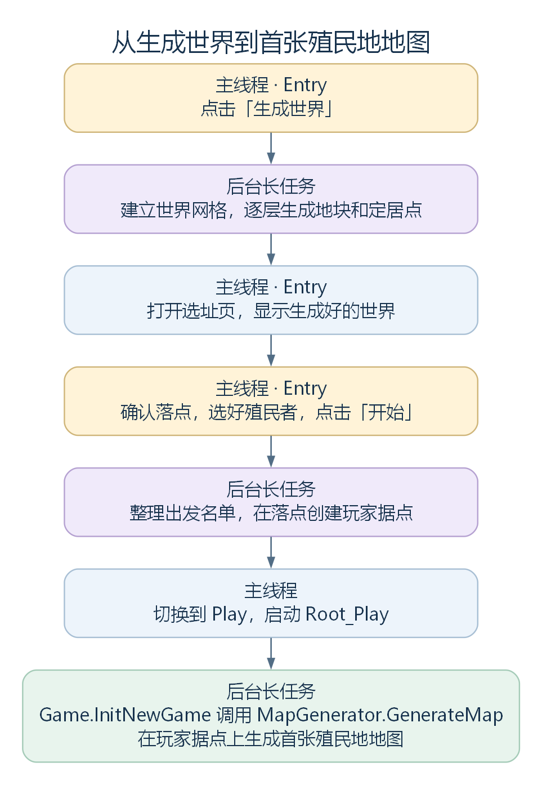
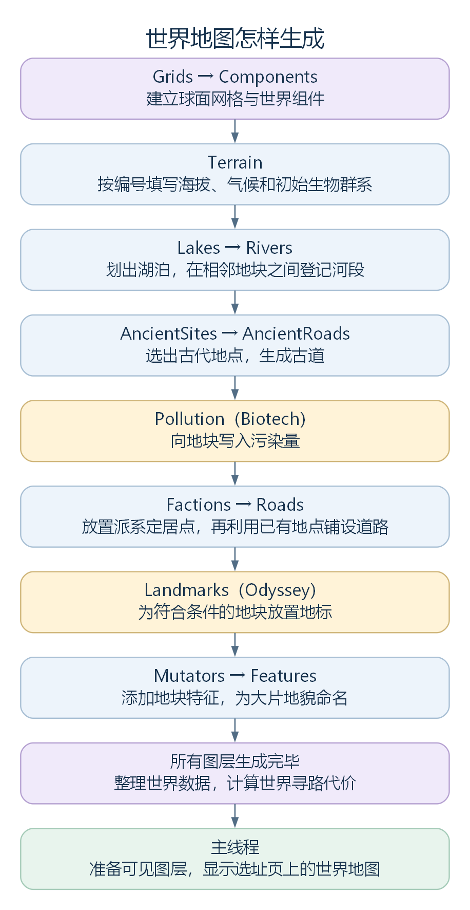

# 从种子到落点：RimWorld 怎样创建世界

发布版 v1.0 · 2026-11-17

点下「生成世界」之后，游戏会先画出可供选址的星球。你可以查看哪里有河流、地块属于什么生物群系、周围有哪些定居点。等选好落点和殖民者，点下最后的「开始」，游戏才在选中的世界地块上生成殖民地地图。

本文依据 RimWorld 1.7.4982 rev1280 的源码和原版 XML，沿普通手动选址的开局展开。

## 世界生成总览



整条流程可以沿 `PlanetTile` 读下去。这个值用图层编号和层内地块编号表示一个世界位置。生成时，游戏用它定位地块。选址时，界面用它读出地形、气候和附近的据点。开始游戏时，确认的位置会写到玩家据点上，成为第一张殖民地地图的位置。

## 一、把世界设置交给生成任务

在主菜单点「新建殖民地」会打开剧本选择页。确认剧本时，`Page_SelectScenario` 创建 `Game`，并建立用于暂存开局设置的 `GameInitData`。剧本把叙事者、世界参数和选址等页面依次接起来。选完叙事者、难度和存档模式后，就能设置世界种子、覆盖率、气候、派系和人口等参数。

点「生成世界」时，参数页把生成工作交给 `LongEventHandler` 的异步长任务，页面留到生成结束才切换。后台任务先清掉可能已有的世界、落点、玩家派系引用和候选殖民者，再把当前参数交给 `WorldGenerator.GenerateWorld()`。从选址页返回改种子再生成，也是走这个入口。

## 二、先铺球面网格，再生成各层

生成器新建 `World`，把设置写进 `WorldInfo`，再暂存到 `Current.CreatingWorld`。这样，生成步骤已经可以用 `Find.World` 取得正在建立的世界。

全局准备先执行 `Grids`。它建立各图层的球面网格，也创建供远行寻路使用的 `WorldPathGrid`。例如，选择 30% 覆盖率时，地表生成角度是 `0.3 × 180° = 54°`。游戏从粗略的球面网格开始细分，按这个角度保留地块，并根据共边关系记录邻格。随后的 `Components` 步骤建立世界对象列表、派系管理器等对象，供各层生成时使用。

准备完成后，`GenerateWorld()` 按图层编号依次生成各层。每层的定义列出自己需要哪些生成步骤，游戏再按步骤的 `order` 排序，同值时按 `index` 排序。每一步从世界种子派生自己的随机起点，因此前一步多取几次随机数，后一步仍能从自己的起点开始。步骤之间通过已写好的地块和世界对象传递结果。

## 三、逐步生成世界地图上的内容



### 3.1 填入地块资料，再划分水域

以普通开局的地表层 `Surface` 为例。`Terrain` 先准备海拔、气候和山地等计算函数，再交给父类 `WorldGenStep_Tiles` 遍历网格。这里的 `layer` 是地表层，`i` 是当前地块编号。每次循环都用两者构成 `PlanetTile`，由 `Terrain` 重写的 `GenerateTileFor()` 生成一格 `SurfaceTile`，再按编号放进 `Tiles`。

```csharp
layer.Tiles.Clear();
for (int i = 0; i < layer.TilesCount; i++)
{
    Tile tile = this.GenerateTileFor(new PlanetTile(i, layer), layer);
    layer.Tiles.Add(tile);
}
```

到这里，每格已有海拔、山地程度、气温、降雨、沼泽程度和初始生物群系。`Lakes` 在这些地块中找出较小的相连海洋水域，将它们改为湖泊。`Rivers` 继续读取地形和气候，确定水系，再把河段登记到相邻地块之间。

### 3.2 生成古道、派系定居点和普通道路

`AncientSites` 先选出一批古代地点，`AncientRoads` 以这些地点为节点生成古道。启用 Biotech 时，接下来的 `Pollution` 会按世界污染设置等条件给地块写入污染值。

随后，`Factions` 根据参数页选定的派系定义，创建能出现在本层的派系。创建可见的非玩家派系时，游戏也会放下一座初始定居点。然后它按地块数、覆盖角度、人口档位和该层的定居点密度估算目标数量，扣掉已有的定居点，再补上余下的数量。补建的定居点按权重选派系，选址时还要考虑群系、温度和附近是否已有据点。

定居点和其他世界对象已经有了位置，`Roads` 就能从这些地点取一批道路节点，再加入额外选出的节点，生成普通路网。

### 3.3 添加地标、地块特征和地区名称

启用 Odyssey 时，`Landmarks` 会在道路生成后为符合条件的地块放置地标。`Mutators` 接着根据山地、岸线、河段和地标等条件添加地块特征。最后，`Features` 找出山脉、海湾等大片地貌，生成能在世界地图上显示的名称。

## 四、整理世界数据，打开选址页

所有图层生成完毕后，游戏整理地块数据，计算世界寻路代价，准备环境音，并做完世界组件的初始化。接下来剧本创建玩家派系。未启用 Ideology 时，这里也会让剧本生成候选殖民者。启用 Ideology 时，候选人会在之后确认文化形态时准备。

生成器恢复进入时的随机状态，清掉暂存的世界入口，再把新世界返回给长任务，由任务将它写入 `Current.Game.World`。主线程发现后台任务结束后，打开选址页、重建可见的世界绘制图层，再关闭参数页。

## 五、查看地块并确认落点

在世界地图上点一格时，选择器用鼠标位置从世界相机发出一条射线。命中世界地图后，游戏把命中位置换成 `PlanetTile`，存为当前选中的地块。「地形」页用这个编号从 `WorldGrid` 取出对应的 `Tile`，显示海拔、降雨等数据。

浏览时，选址页会把所选地块或所选世界对象的位置暂记到 `GameInitData.startingTile`。按「下一步」时，页面重新读取当前选中的地块。以点击定居点图标为例，页面可以查看这个对象所在的位置，继续选址时还要选中一块有效地块。

接下来 `TileFinder.IsValidTileForNewSettlement()` 检查群系、山地程度、本格和邻格的据点等条件。通过检查后，若需要提示附近派系关系的影响，游戏会等玩家确认。随后页面把通过检查的 `PlanetTile` 写回 `startingTile`，进入后续配置。

## 六、把落点交给第一张殖民地地图

最后一页点「开始」时，`PageUtility.InitGameStart()` 登记一项切换到 `Play` 前执行的后台长任务。它依次调用这两个方法。

```csharp
Find.GameInitData.PrepForMapGen();
Find.Scenario.PreMapGenerate();
```

`PrepForMapGen()` 整理出发名单，将未入选的候选人交给 `WorldPawns` 保留，并设置出发者的派系和初始工作优先级。接着，剧本的 `PreMapGenerate()` 读取确认好的 `startingTile`，在世界对象列表中登记玩家的 `Settlement`。

这个任务完成后，主线程切换到 `Play`。`Root_Play.Start()` 再登记一项后台长任务来执行 `Game.InitNewGame()`。它找到刚登记的玩家据点，记下开局落点，再将据点和地图尺寸交给 `MapGenerator.GenerateMap()`。世界地图上的一格就这样成为首张殖民地地图的位置。

[完整解析版](article.md) · [气候与地形规则](01-climate-terrain-rules-release.md) · [世界数据的存储与查询](02-world-data-storage-query-release.md) · [第七章目录](README.md)
